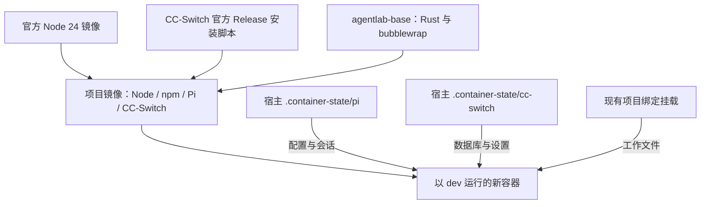

# Node.js、Pi 与 CC-Switch CLI 容器配置 - Plan

## Goal Capsule

- Objective：开发者重建容器后可立即使用最新稳定版 Pi 和 CC-Switch CLI，并继续访问保存的配置与会话。
- Means：镜像提供 Node/npm/Pi/CC-Switch，宿主项目目录保存运行数据（KTD1–KTD3、KTD5）。
- Authority：[036 规格](../specs/036-node-pi-container.md) R1–R8 与 [037 规格](../specs/037-cc-switch-container.md) R1–R5 是行为与验收依据；本计划规定实现方式。
- Boundary：按用户后续指令，本次交付配置文件和现有数据迁移，不构建镜像或重建容器；运行验收在将来实际构建后执行。
- Delivery：后续实施方完成 U1–U4 及项目规定的验证，验收方按规格判定；不自动提交或发布。

---

## Product Contract

### Summary

在开发容器配置中加入 Node.js 24 LTS、npm、构建时最新稳定版 Pi Coding Agent 和 CC-Switch CLI。两项工具的全局数据分别绑定宿主项目目录，升级程序与保存数据分别处理。

### Problem Frame

容器中手动安装的软件不会自动进入镜像。删除容器后重建会丢失这部分安装，尚未挂载的 Pi 数据也存在同样问题。

### Requirements

Node/Pi 的要求以[036 规格第 1 节](../specs/036-node-pi-container.md#1-要做什么有哪些要求)为准：U1 对应 R1–R3、R7，U2 对应 R4–R7，U3 对应 R8 及验收汇总。CC-Switch 的要求以[037 规格第 1 节](../specs/037-cc-switch-container.md#1-要做什么有哪些要求)为准，由 U4 实现、U3 汇总验证。下文未加规格前缀的 R-ID 指 036。

### Scope Boundaries

不扩展 Rust 应用、模型配置或第三方 Pi 插件。CC-Switch 只安装程序和持久化自身数据，不自动切换供应商、登录、同步其他 Agent 配置或启动代理服务。不为本次全局 npm 安装新增项目 JavaScript 工程或依赖锁文件；`latest` 是明确要求，实际安装版本与镜像标识记入证据，不宣称依赖树完全可复现。

---

## Planning Contract

### Key Technical Decisions

- KTD1. 使用官方 npm 包 `@earendil-works/pi-coding-agent@latest`。当前[官网](https://pi.dev/)要求安装时带 `--ignore-scripts`；避免复用旧包名或把用户目录里的安装文件拷入镜像。遵守 R1、R7。
- KTD2. 使用官方 `node:24-bookworm-slim` 阶段提供 Node/npm，将必要运行文件与链接带入现有最终镜像。Node 24 是当前受支持且满足 Pi `>=22.19.0` 要求的 LTS；最终 `FROM` 仍为 `agentlab-base:latest`。不整目录覆盖基础镜像的其他工具，不使用 Alpine 的 musl 二进制。遵守 R2、R7。
- KTD3. 将 Pi 安装到系统路径，并保证该启动器优先于用户目录中的旧启动器。将宿主项目的 `.container-state/pi` 绑定到 `/home/dev/.pi`；先复制现有数据、校验内容并保留旧目录，再用符号链接让当前容器也直接使用持久目录。不依赖当前不可用的 Docker 引擎创建新命名卷。遵守 R3–R6。
- KTD4. 主动更新先单独拉取官方 `node:24-bookworm-slim`，再不带全局 `--pull` 执行无缓存项目构建。全局 `--pull` 会尝试拉取所有引用镜像，不能假定本地 `agentlab-base:latest` 也有可拉取的远程副本。README 区分构建代理、镜像拉取代理与已有运行时代理，不把代理地址或凭证写入镜像 ENV。遵守 R8、R7。
- KTD5. CC-Switch 使用用户指定的官方 Release 安装脚本。构建时将 `CC_SWITCH_INSTALL_DIR=/usr/local/bin`、`CC_SWITCH_FORCE=1` 仅传给脚本执行进程，避免默认安装进 root 的用户目录及已有目标触发交互确认；先确保脚本下载成功，再由 Bash 执行，任一步失败即中止构建。保留脚本在 Linux 自动选择静态 musl 发行包的行为，不另写架构下载器。将宿主项目的 `.container-state/cc-switch` 绑定到 `/home/dev/.cc-switch`；当前没有旧数据时只准备空持久目录。沿用官方默认数据路径，不新增配置路径覆盖变量。遵守 037/R1–R5。

### High-Level Technical Design

### Dependencies and Constraints

构建前核实本地基础镜像可用、最终系统与 Node 动态库兼容。当前 Compose 的 seccomp 使用 Windows 宿主绝对路径，部署验收需在该宿主或等效正确路径下执行；规划不改动这一既有边界。

将安装成功与模型访问分开验证：本任务不需要真实 API Key，不新增凭证或供应商配置。现有 `.pi` 和 `.cc-switch` 数据只在实施部署时做受保护备份，不在日志中展示；如存在 CC-Switch 旧数据，停止相关写入进程后再备份迁移，保留数据库及其相关文件，不覆盖非空目标卷。

---

## Implementation Units

### U1. 镜像安装 Node/npm 与最新 Pi

**Goal / Requirements：** 满足 R1–R3、R7。无前置实施单元。

**Files：** `.devcontainer/Dockerfile`；新增验收文件 `scripts/acceptance/036-node-pi-container.sh` 的软件检查部分。

**Approach：** 按 KTD1、KTD2 引入官方 Node 阶段，在最终镜像中安装 Pi；保留现有 Rust、bubblewrap 和 `USER dev`。只带入所需文件并建立正确命令链接，安装失败不得继续产出可交付镜像。

**Execution note：** 这是软件打包，先用临时镜像的真实运行检查建立证据，不新增照抄 Dockerfile 文本的单元测试。

**Test scenarios：**

1. dev 在普通 shell 和非登录 shell 中调用 Node/npm/Pi，版本命令成功，Pi 版本符合构建时记录的 registry 结果。
2. 挂载含旧启动器的假数据目录，确认实际 Pi 入口仍来自新镜像。
3. 无真实密钥且使用隔离目录时版本与帮助命令成功；没有 Node 或 Pi 的对照镜像不能通过同一断言。

**Verification：** 临时镜像的命令可用性、版本、PATH 与运行依赖检查通过；记录实际 Node/npm/Pi 版本及镜像标识。

### U2. 持久化 Pi 数据并保留旧数据

**Goal / Requirements：** 满足 R4–R7。依赖 U1。

**Files：** `.devcontainer/Dockerfile`、`.devcontainer/compose.yaml`、`README.md`；同一验收脚本的数据保留部分。

**Approach：** 按 KTD3 增加宿主绑定挂载，使用项目已有的 bind 长语法。README 写明备份、迁移、权限核对与恢复方式；迁移不删除原数据或既有卷。

**Test scenarios：**

1. 新空卷挂载后 dev 能写假配置与会话标记。
2. 同一临时容器停启后数据一致；删除临时容器、以同一镜像与同一卷创建新容器后仍一致。
3. 将模拟旧目录迁入临时卷后，内容保持一致且 dev 可写；去掉持久挂载的对照能够被测试识别。

**Verification：** 检查 Compose 渲染结果的新挂载和既有挂载，真实容器生命周期测试通过；验证过程只使用临时资源。

### U4. 镜像安装 CC-Switch CLI 并持久化自身数据

**Goal / Requirements：** 满足 037/R1–R5。依赖 U1、U2，复用其镜像与临时资源验收结构。

**Files：** `.devcontainer/Dockerfile`、`.devcontainer/compose.yaml`、`README.md`；构建验收脚本留待后续运行验收。

**Approach：** 按 KTD5 在 root 构建阶段调用官方安装器，最终仍以 dev 运行。README 说明镜像内的安装目录、数据绑定、旧数据迁移与无缓存更新方式。版本信息由将来实际安装结果记录，不写死调研时的 `5.11.3`。

**Execution note：** 先验证真实安装、非交互失败传播及 dev 的命令可用性；不为安装器内部函数新增测试，不执行供应商切换或配置同步。

**Test scenarios：**

1. dev 在普通 shell 和非登录 shell 执行 `cc-switch --version`、`cc-switch --help`，入口来自镜像系统路径，版本符合该次构建解析的 Release。
2. 安装脚本下载失败或脚本返回非零时，构建不能报告成功；已有目标程序时构建无须人工确认。
3. 在隔离用户目录及全新临时卷中用真实 CLI 初始化自身数据库，写入假设置或标记；停启和删除容器重建后数据库仍可打开、测试数据保留且 dev 可写。
4. 检查缺少 CC-Switch 程序或去掉其卷挂载的对照能被同一断言识别。测试进程的 HOME、CC-Switch 配置目录及已有 Agent 路径变量均指向临时夹具，不能读写真实 Agent 配置。

**Verification：** 官方脚本构建安装、版本/PATH、dev 权限与持久化验证通过；没有自动执行登录、供应商切换、配置同步或代理启动。

### U3. 更新说明与交付验证

**Goal / Requirements：** 满足 R8，并汇总 036/R1–R7 和 037/R1–R5 的验证。依赖 U1、U2、U4。

**Files：** `README.md`、`scripts/acceptance/036-node-pi-container.sh`、`docs/logs/036-node-pi-container/`、`docs/logs/037-cc-switch-container/`。

**Approach：** 按 KTD4 补充初次构建、主动更新、进入容器、备份迁移说明。验收入口统一输出结果与退出码，使用独立镜像标签、容器名、临时卷和假数据；不要直接对固定名 `agentlab-demo-dev` 做删除或重建测试。

**Test scenarios：**

1. 刷新构建重新获取 Node 24 最新补丁、Pi `latest` 及 CC-Switch 最新稳定 Release；版本检查按同次构建解析结果判断，不能固定为调研时版本。
2. 完整验收在没有供应商密钥的条件下运行，失败返回非零，结束后清理自己的临时资源。

**Verification：** 完成下述验证契约，并把规格更新到“待验收”；不由实现方宣称验收已通过。

---

## Verification Contract

以下是后续实施的验证安排，本轮全部未执行。

按用户缩小后的交付范围，本次不新增会构建镜像的验收脚本、不执行以下镜像构建与生命周期用例。替代验证包括 YAML/Dockerfile 解析、安装命令语法、保留既有配置的对比、数据复制一致性与当前目录链接写入检查；未来运行验收仍保留本节契约。

| 检查 | 入口与范围 | 通过依据 |
|---|---|---|
| Compose 配置 | 宿主仓库根目录：`docker compose -f .devcontainer/compose.yaml config --quiet` | 配置可解析，挂载检查确认新增 Pi、CC-Switch 卷且保留原挂载 |
| 镜像与持久化验收 | 宿主仓库根目录：拟新增 `bash scripts/acceptance/036-node-pi-container.sh` | U1、U2、U4、U3 的真实命令与容器生命周期场景全部通过 |
| 主动更新 | README 提供单独拉取官方 Node 镜像、再无缓存构建项目的入口，保留本地基础镜像 | 实际版本与刷新时解析的官方稳定版本一致 |
| 项目质量流程 | 按 AGENTS.md 顺序完成 comprehensive-testing、安全测试、ce-simplify-code、ce-code-review | 只处理本任务相关问题，审查前读取 `rules/REVIEW.md` |
| 全量回归 | 容器内仓库根目录：`cargo check && cargo test --workspace --no-fail-fast` | 报告通过、失败、忽略与未执行数量；使用 Cargo.lock，不升级依赖 |

全量回归应在新镜像的隔离项目副本中执行，并指定副本专用 `CARGO_TARGET_DIR`，避免污染当前并行开发。沙箱环境按项目现有契约处理，任何关闭沙箱的检查必须另行标注，不能代替默认配置验证。全量入口已覆盖的 CLI/PTY 用例不重复运行。

公共容器及 Node/Pi 证据保存在 `docs/logs/036-node-pi-container/`，CC-Switch 专属证据保存在 `docs/logs/037-cc-switch-container/`，相互引用而不重复抄写。记录实际命令、工作目录与关键结果。规划文档检查只核对内容、路径与链接；不执行本节的构建和测试。

---

## Definition of Done

- 036/R1–R8 与 037/R1–R5 有对应证据，新增验收入口及项目全量验证满足各自完成条件。
- README 能指导初次构建、主动更新与旧数据保留，程序来自镜像，数据来自宿主项目持久目录。
- 没有改动其他 Agent 的配置或真实数据，没有遗留失败方案代码和临时测试资源。
- 验证未执行、环境阻塞和既有失败单列，不计入通过；验收方依据规格判定最终状态。

## Sources

- [调研汇总与原始输出](../think-tank/2026-10-29-node-pi-container.md)。
- [CC-Switch 调研汇总与原始记录](../think-tank/2026-10-29-cc-switch-container.md)及[官方安装说明](https://github.com/SaladDay/cc-switch-cli/blob/main/README.md#-installation)：决定 KTD5。
- [Pi 官方安装入口](https://pi.dev/)与[npm 当前 latest 元数据](https://registry.npmjs.org/@earendil-works/pi-coding-agent/latest)：决定 KTD1 及 Node 兼容要求。
- [Node 官方发布周期](https://nodejs.org/en/about/previous-releases)：决定 KTD2 的 LTS 选择。
- [Docker 多阶段构建](https://docs.docker.com/build/building/multi-stage/)与[命名卷生命周期](https://docs.docker.com/engine/storage/volumes/)：决定 KTD2、KTD3。
- [Docker 构建代理](https://docs.docker.com/build/building/variables/#proxy-arguments)：决定 KTD4。
- [Docker build 的全局 pull 行为](https://docs.docker.com/reference/cli/docker/buildx/build/)：决定 KTD4 对本地基础镜像的处理。
