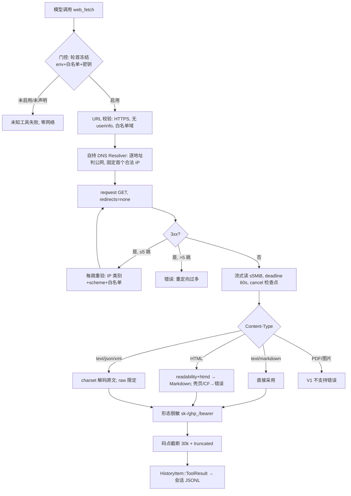
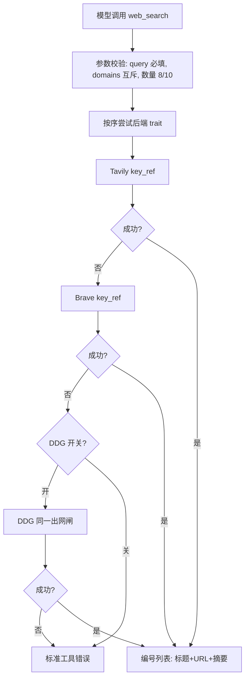

# 042 内置 Web 工具（web_fetch＋web_search） - Plan

> 语言说明：本文件使用 ASD-STE100 中文近似规则，目标约 80% 达标。短句、主动语态、一句一指令、统一术语。保留技术名、代码标识、文件名和产品术语。

## Goal Capsule

- **Objective:** 模型的会话可以安全引用互联网内容——抓取的网页以 Markdown 进入历史，搜索结果可溯源，宿主进程新增的出网面被拒绝式默认与 SSRF 闸约束。默认关闭；关闭时程序行为与今天逐字节一致。
- **Means:** 本地执行的两个基元工具 web_fetch 与 web_search，pi-web-access 底层逻辑为蓝本（KTD1、KTD2、KTD3）。
- **Authority:** 项目规则（/workspace/AGENTS.md）高于本计划；本计划高于实现时的自由裁量。规格文档按项目流程另写 `docs/specs/042-web-access.md`，须链接调研汇总与各专家原始输出。
- **Execution profile:** 单 PR。分支自 `main` 切出（等 038 合并后开工；若 038 未合并，从其分支 rebase 基线另议）。分支与构建遵循 AGENTS.md §8：副本目录跑 Cargo 必须显式 `--target-dir`。
- **Stop conditions:** Tavily/Brave 密钥未注册不阻塞交付（R5：后端不可用＝工具不声明）。DDG 兜底的 100 连发实测若封禁率过高，按 Verification Contract 的判据把开关默认置 false 或整体延后，不算失败。

---

## Product Contract

### Summary

给 terminal-chat 增加两个模型可调用的内置工具：web_fetch（HTTPS 抓取→正文提取→Markdown）与 web_search（单查询→编号结果列表）。两工具在宿主进程内本地执行，经可信环境变量门控默认关闭，域名白名单拒绝式放行，SSRF 闸装在 DNS 解析层。V1 只做 readable/raw 两种抓取模式与静态搜索结果列表。

### Problem Frame

模型的工具环再完整，对互联网也完全失明：查文档、搜报错、看 issue 都做不到。四家对标产品（Claude Code、Codex、ZCode、pi 生态）都内置 web 能力，这是本项目唯一整块缺席的基线能力。同时，这是宿主进程第一次模型可触发的任意出网：bwrap 沙箱只包子进程，进程内出网没有任何既有治理面，安全边界必须与功能同批交付。调研（`docs/think-tank/2026-11-01-039-web-access.md`）确认 pi 上游核心不带 web 工具，成熟方案是其扩展 pi-web-access；Codex 走托管路线（对比见 `docs/records/2026-11-01-039-web-access-codex-comparison.md`），绑定单一供应商且无本地抓取。

### Key Decisions

- KD1. 功能＝内置 web_fetch＋web_search，V1 范围＝readable/raw＋静态搜索结果。 (session-settled: user-directed — chosen over headless 执行模式与检查点回滚：web 能力是对标产品全有、本项目唯一整块缺席的基线能力) Governs R6-R16。
- KD2. 路线＝本地执行，参考实现 pi-web-access；不采用 Codex 托管工具路线。 (session-settled: user-approved — chosen over 托管路线与移植 pi 上游：上游核心无 web 工具；托管绑定单一供应商且无本地抓取) Governs R1-R5, R7, R11。
- KD3. 不接 031 审批体系：宿主进程出网不在 bwrap/031 射程内，控制面＝环境门＋白名单。Governs R1-R5, R17。

### Requirements

分组按能力；R-ID 连续。

**门控与信任**

- R1. 默认关：门控环境变量未设时，两工具不声明、不可执行；伪造调用按未知工具失败，且零网络活动。
- R2. 门控变量 `TCHAT_WEB_ACCESS` 非空即启；设为空串或未登记值＝启动失败（仿 `TCHAT_PERMISSION_POLICY` 的显式拒绝）。变量必须注册进 `TRUST_CONTROL_VARS`，`.env` 不得启用它。
- R3. 启用状态在用户轮开始时冻结；轮内变化只影响下一轮。记忆合并轮（merge）不声明、不执行。
- R4. 域名白名单拒绝式默认（约束 web_fetch）：已启用但白名单为空或缺失＝web_fetch 不声明；web_fetch 目标域必须命中白名单（精确或子域）。web_search 的声明态只按 R5 密钥判定，不受白名单门控（KTD7）。
- R5. web_search 后端密钥经既有 key_ref 体系解析；某后端密钥不可解析＝该后端不可用；全部后端不可用＝web_search 不声明。

**web_fetch 行为**

- R6. 仅接受 `https://` URL；`http://` 与其他 scheme 一律拒绝（较参考实现有意收紧，规格注明）；拒绝 userinfo；目标域必须命中白名单。
- R7. SSRF 防护装在自持 DNS 解析层：逐地址判公网（拒绝环回、RFC1918、169.254.0.0/16、IPv6 ULA 与链路本地、组播、未指定、IPv4-mapped）；首个通过校验的地址固定用于连接；重定向手动循环 ≤5 跳，每跳重验地址类别＋scheme＋白名单成员资格，任何豁免不随跳转传递；禁用环境代理。
- R8. 响应体流式计数上限 5 MiB，超限中止连接；固定墙钟时限（连接 10 秒、总 60 秒）；用户取消在每跳与每读块检查点生效，中止在途连接并返回取消态。
- R9. 内容分支：`text/markdown` 直接采用；HTML 经 readability 提取＋htmd 转 Markdown，正文低于可用阈值回退原文提取；JS 壳页或 Cloudflare 质询返回结构化错误；`text/*`、JSON、XML 按 charset 解码原文；`mode=raw` 仅接受文本类型；PDF 与图片返回 V1 不支持错误。
- R10. 结果契约 `{url, title, content, truncated, error, mimeType?, status?}`：正文按 Unicode 码点截断（默认 30_000 字符），截断以布尔 `truncated` 表达，无内联省略号。

**web_search 行为**

- R11. 单 query 必填；`allowed_domains` 与 `blocked_domains` 互斥，同给＝参数校验错误；结果默认 8 条、上限 10 条。
- R12. 后端藏在单一 trait 之后：Tavily＋Brave 常驻，DuckDuckGo 兜底仅当配置开关开启；后端按序回退；单后端失败映射为标准工具错误（无效密钥、限流、畸形响应各有文案）。
- R13. 返回编号列表：标题＋URL＋摘要；不自动抓取结果页。

**结果处理与安全边界**

- R14. 结果正文与摘要在入史前做形态脱敏（sk-、ghp_、bearer 赋值等正则集，复用 `memory/secrets.rs` 先例）；工具调用参数按既有惯例原样持久化。
- R15. 抓取与搜索结果按不可信数据处理：宿主不解析其中指令；TUI 显示副本过 `sanitize_for_terminal`。
- R16. token 计量复用 `approx_tokens_from_byte_count`；出站请求不附带任何用户凭证、Cookie 或会话态。

**接线与渲染**

- R17. 声明与执行同门（030 骨架）：轮首按门控构建 Option 定义，分派分支同门校验；四处接线一致——主分派链、子代 `dispatch_child_tool`、`dispatch_nested_leaf`、JS 编排 `orchestration_catalog` 名单。
- R18. TUI 提供实时活动行与结果卡片分支；未知工具降级路径保持不变（现有 web_search 字面量降级测试即回归锚）；`/resume` 投影与实时一致；CLI 沿用通用活动行。

**平台与兼容**

- R19. 全平台同语义，不加 cfg 平台门；请求组装的关闭路径与既有入口逐字节一致（`tests/prompt_assembly.rs` 差分沿用）。
- R20. 默认（关闭）态零行为变化；开启态不改变任何既有工具契约。

### Success Criteria

- S1. SSRF 矩阵离线全过：公网域名解析到环回/RFC1918/169.254.169.254 一律拒绝；重定向到私网目标在跳点被拒。变异锚：注释逐跳复验，对应测试必须变红。
- S2. 提取质量 golden 契约通过：入库 Mozilla test-pages 代表例，与 readability-rs 上游实测基线（119/130）对照不回退。
- S3. 脱敏到达持久化会话文件：mock 正文植入 `sk-`/`ghp_` 形态串，断言 JSONL 落盘中已替换。
- S4. PTY e2e 全离线：模型轮内调用两工具（录制的搜索后端＋本地 mock HTTP），屏幕渲染与下一请求可断言。
- S5. 全量 `cargo check && cargo test --workspace --no-fail-fast` 绿；关闭路径差分测试保持逐字节一致。

### Scope Boundaries

**Deferred to Follow-Up Work**（明确的后继项，不在本计划）

- 全文磁盘缓存＋翻页取回工具（`get_search_content` 等价物）。
- 031 审批体系对进程内出网的扩展。
- PDF 提取、图片内容返回、视频抽帧、GitHub/YouTube 特殊路由。
- `answer`/`extract` 高级模式。
- AGENTS.md §8「十三个模块」表述已过时（lib.rs 实测 24 个），属用户维护的项目信息，本计划只提醒不代改。

**Outside this product's identity**（考虑过、判定不做，附理由）

- POST/PUT、Cookie 与会话态、附带用户凭证——变更外部世界的动作属 exec 的受审计领地，抓取工具只读。
- 自动抓取搜索结果页——隐藏中间证据、破坏逐步取消，组合属模型循环或 JS 编排。
- workflow 型「research」聚合工具——同上，基元形状正确。
- 搜索后端自动重试——后端按序回退已覆盖瞬时失败；重试语义归 040（请求重试）管辖。

---

## Planning Contract

### Key Technical Decisions

- KTD1. 进程内本地执行两基元工具。 (session-settled: user-directed — chosen over Codex 托管工具路线：五协议通用、不依赖模型供应商能力、具备完整本地抓取)
- KTD2. 参考实现 pi-web-access，宿主无关核心＋本项目宿主适配的分层照搬。 (session-settled: user-approved — chosen over 移植 pi 上游：上游核心无 web 工具，扩展生态才成熟)
- KTD3. HTTP 客户端＝reqwest async＋模块自持 tokio runtime（`block_on` 桥接同步分派链），先例 `mcp/manager.rs`；自实现 `Resolve` 把 SSRF 闸装进解析层。理由：ureq 2.12.1 无自定义 resolver API；reqwest 0.13.4 的 blocking 与 async builder 均暴露 `dns_resolver`（审查实证），选 async 桥是沿用树内 mcp 先例，且流式读块与取消检查点在 async 侧表达自然（blocking 需新开 feature，整读阻塞难以逐块取消）——有依据的取舍。解析层闸消 TOCTOU，强于请求前校验。与 api.rs 的 ureq Agent 不共享实例。
- KTD4. 门控样板＝`TCHAT_SANDBOX`/`TCHAT_PERMISSION_POLICY`（非空即启＋显式拒绝歧义值），非模型目录能力开关；变量注册 `TRUST_CONTROL_VARS`（catalog.rs:236）＋dotenv 拒绝测试；轮首冻结（021/030 语义）；全平台无 cfg 门。
- KTD5. 白名单拒绝式默认；重定向每跳校验地址类别＋scheme＋白名单成员（防 whitelisted.com→evil.com 逃逸）；resolver 做成可注入接缝——离线测试与本地 mock 可达的前提。
- KTD6. 提取链＝readability-rs＋htmd＋chardetng（BOM→响应头→meta→嗅探）；壳页判定（可见文本<500 字且 script>3）与 Cloudflare 质询（403/503＋cf-mitigated 头）返回结构化错误，不接渲染后端。
- KTD7. 搜索后端单一 trait；Tavily＋Brave 常驻，DDG 兜底为配置开关且走同一出网闸路径；密钥经 `resolve_credential`（`env:` scheme）；声明前检查密钥可解析（不满足即不声明）。后端固定域（api.tavily.com 等）是工具自身信任根，不经用户白名单过滤——白名单只约束 web_fetch 目标域（R4、R6），否则搜索在空白名单下永远不可用，与 R5 矛盾。
- KTD8. 生命周期有意区别于 016：无会话句柄、不跨轮存活；取消＝检查点协作中止（每跳/每块，`AtomicBool`，view_image 模式），时限到期＝终态失败；截止失败不落正文，内联截断落正文＋`truncated=true`，两者契约分离。
- KTD9. 结果成形复用既有件：`cap_output` 码点截断语义（默认档 30_000）、`HistoryItem::ToolResult` 既有回流通道（分派分支内返回前自脱敏——链上无通用脱敏钩子）、计量 `approx_tokens_from_byte_count`；脱敏正则集自 `memory/secrets.rs:22` 移植，替换值用既有 `[REDACTED_SECRET]`。脱敏与截断顺序固定为先脱敏后截断（防截断边界切开密钥串致半截未脱敏落盘）；截断点落入替换串内部时回退至该串起点，不产生半个替换串。
- KTD10. 子代与 JS 叶子继承＝显式规格行＋四处接线（R17）＋registry-parity 测试；不做静默继承。
- KTD11. 031 边界显式声明：`TCHAT_PERMISSION_POLICY` 的 `--unshare-net` 只包子进程；042 工具在 policy 模式下仍由自身门控治理，规格写明该边界，031 的网络隔离承诺不得外溢表述。

曾接近 Bake-off 的决策：HTTP 传输（blocking reqwest vs async＋tokio 桥）。审查实证两条路径均可承载解析层闸（reqwest 0.13.4 两侧皆有 `dns_resolver`），不构成 Bake-off 的依据改为：async 桥有树内先例且逐块取消语义更自然，属有依据取舍而非无可选项。

### High-Level Technical Design

抓取管线（门控→校验→抓取→分支→成形）：

web_search 后端选择：

接线拓扑（四处声明/执行同门点）：主分派链（turn.rs `turn_body_inner` else-if 链）、子代 `agents/runtime.rs dispatch_child_tool`＋ChildSpec、`turn.rs dispatch_nested_leaf`、JS 编排 `orchestration_catalog` 名单——四处读同一轮首冻结的门控快照。

### Assumptions

- Mozilla test-pages 夹具入库选代表例（约 20-30 例）而非全部 130 例，阈值对照在规格期定案。
- 固定时限常量（连接 10s；fetch 总 60s；search 总 30s）首版不可配置，常量集中于 web_access 模块一处。

### Risks & Dependencies

- 新依赖 readability-rs、htmd、chardetng 进 `--locked` 工程：声明与锁文件同步更新并验证受影响范围（AGENTS.md §6）；readability-rs 为 0.1.x 单作者 crate，弃坑风险以 golden 基线锁定，必要时换 `@mozilla/readability` 等价移植。
- reqwest 0.13 API 面与 0.12 资料不同（无 webpki-roots feature；TLS 根＝aws-lc-rs＋platform-verifier）：`no_proxy` 与禁环境代理的写法按 0.13 文档核实，不照抄旧资料。
- DDG HTML 端点稳定性：社区证据显示验证码频发；兜底默认关闭，开启与去留由 100 连发实测判据决定。
- 外泄通道（宿主进程新信任面）：模型可把会话内习得的任意内容编入 URL 或搜索查询，发往白名单外主机。既有缓解：仅 HTTPS GET（R6）、出站不附带凭证与 Cookie（R16）、URL 在 TUI 可见（R18）。接受为剩余风险，规格威胁模型一节显式记录。
- 多次截断结果同轮叠加推高上下文占用：内联上限已封顶单条；032 计量自然计量，不新增口径。
- Windows 首编译面：全平台无 cfg 门；038 登记的 Windows 平台移植（lib 既有 62 处编译缺口）落地前，CI Windows 腿常态红、无法为新模块出证——PR 期以依赖 windows 目标声明的静态核对替代，模块级编译验证登记为验证缺口（AGENTS.md §7）。

### Sources & Research

- 调研汇总（四裁决＋组合方案）：`docs/think-tank/2026-11-01-039-web-access.md`
- 参考实现考古（pi-web-access 底层逻辑＋上游证据）：`docs/think-tank/raw/2026-11-01-039-web-access-参考实现考古.md`
- Codex 托管路线对比：`docs/records/2026-11-01-039-web-access-codex-comparison.md`
- 各专家原始输出（HTTP/SSRF、提取、搜索后端、项目集成、侦察兵）：`docs/think-tank/raw/2026-11-01-039-web-access-*.md`
- 代码锚点（本轮 repo-research 已核实）：`src/app/src/prompt.rs:873`（build_turn_request_with_agents）、`src/app/src/turn.rs:2207`（view_image 分支样例）、`src/app/src/mcp/manager.rs:13`（tokio 桥先例）、`src/app/src/catalog.rs:236`（TRUST_CONTROL_VARS）、`src/app/src/catalog.rs:301`（resolve_credential）、`src/app/src/exec.rs:302`（cap_output）、`src/app/src/memory/secrets.rs:22`（形态正则先例）、`src/shims/codex-utils-string/src/truncate.rs:96`（ceil(B/4)）、`src/app/tests/common/mod.rs:133`（spawn_mock）、`src/app/src/tui_host.rs:1894`（web_search 降级回归锚）。

---

## Implementation Units

单 PR 交付；单元按依赖排序。测试全部离线：本地 mock HTTP（`spawn_mock` / `spawn_mock_with_content_type`）＋可注入 resolver（KTD5），不访问真实网络与真实密钥。

### U1. 门控与配置面

- **Goal:** `TCHAT_WEB_ACCESS` 门控、TRUST_CONTROL_VARS 注册、dotenv 拒绝、白名单与后端密钥的配置解析，轮首冻结快照。
- **Requirements:** R1-R5, R19。
- **Dependencies:** 无。
- **Files:** `src/app/src/web_access.rs`（新建，门控与配置部分）、`src/app/src/catalog.rs`（TRUST_CONTROL_VARS 追加）、`src/app/src/config/` 或 `catalog.rs` 配置解析处（`web_access` 顶层键：`allowed_domains`、`search.tavily_key_ref`、`search.brave_key_ref`、`search.ddg_fallback`）、`src/app/src/turn.rs`（TurnExtras 新字段）、测试文件 `src/app/tests/web_access_gating.rs`（新建）。
- **Approach:** 门控快照结构体在轮首装配（021/030 惯例）；声明条件函数供 prompt 与分派两处共用；白名单匹配函数（精确＋子域）纯函数化。
- **Patterns to follow:** `TCHAT_SANDBOX`（sandbox.rs:35 非空判）、`TCHAT_PERMISSION_POLICY`（permissions.rs:18 设空即拒）、030 声明/执行同门骨架、EnvGuard＋ENV_LOCK 测试惯例。
- **Test scenarios:**
  - env 未设：`build_turn_request*` 输出不含两工具定义（请求字节差分）。
  - env 置空串/歧义值：启动失败，文案指明变量。
  - `.env` 写入 `TCHAT_WEB_ACCESS=1`：dotenv 后仍未启用（TRUST_CONTROL_VARS 路径）。
  - 启用＋白名单空：web_fetch 不声明，web_search 按密钥状态声明（R5/KTD7）；启用＋白名单含 `example.com`：`example.com` 与 `a.example.com` 命中、`notexample.com` 不命中。
  - 轮中改 env/白名单：当前轮行为不变，下一轮生效。
  - merge 轮：不声明不执行。
  - 密钥 env 缺失：对应后端不可用；全缺＋DDG 关：web_search 不声明、web_fetch 正常声明。
- **Verification:** 上述场景全绿；关闭路径请求字节与基线逐字节一致。

### U2. SSRF 抓取核心

- **Goal:** 可注入 resolver 的 HTTPS 抓取器：解析层公网闸、固定 IP 连接、手动重定向逐跳三重校验、流式上限、deadline、取消检查点。
- **Requirements:** R6-R8；引用 KTD3、KTD5、KTD8。
- **Dependencies:** U1（白名单匹配函数）。
- **Files:** `src/app/src/web_access.rs`（fetcher 部分）、`src/app/Cargo.toml`（reqwest features 核对：`json`,`stream`,`rustls` 已有）、`src/app/tests/web_access_fetch.rs`（新建）。
- **Approach:** 模块自持 tokio runtime，`block_on` 桥接；`Resolve` trait 实现持白名单与放行函数；resolver 参数化注入（生产＝系统 DNS，测试＝假 resolver）；重定向循环手写，请求重建不透传凭证头；IP 判定用 `cidr` 类 crate 或手写拒绝表（0.0.0.0/8、100.64/10、169.254/16、64:ff9b::/96 等），`to_ipv4_mapped` 先归一。
- **Patterns to follow:** `mcp/manager.rs` runtime 桥、api.rs `agent_with_timeouts` 的时限风格、view_image.rs 的 `AtomicBool` 检查点。
- **Test scenarios:**
  - Covers S1. 假 resolver 把公网域名解析到 127.0.0.1/10.x/172.16.x/192.168.x/169.254.169.254/::1/::ffff:127.0.0.1：连接前拒绝，mock 服务器收到零请求。
  - IP 字面量 URL `https://127.0.0.1/`、`https://[::1]/`：拒绝（解析器不触发路径也要拒）。
  - userinfo URL `https://a@b/`、非 https scheme（`http://`、`ftp://`、`file://`）：拒绝。
  - 重定向 6 跳：错误；重定向到私网目标 host：跳点拒绝（变异锚：注释逐跳复验此测试必须红）。
  - 白名单 `example.com` 目标 301 到 `evil.com`：跳点拒绝（scheme/白名单成员校验）。
  - mock 慢响应超过 deadline：终态超时错误，无正文持久化。
  - mock 返回 >5 MiB：计数中止，内存有界。
  - 取消旗标在读块间置位： promptly 中止，连接关闭（不再有读事件）。
  - 环境变量 HTTP_PROXY/HTTPS_PROXY 设置时仍直连（no_proxy 语义）。
- **Verification:** 上述全绿；正常公网路径（mock 127.0.0.1 经注入 resolver 放行）完整取回。

### U3. 内容分支与提取

- **Goal:** Content-Type 分支、readability＋htmd 提取、charset 解码、壳页/CF 检测、raw 模式限制。
- **Requirements:** R9；引用 KTD6。
- **Dependencies:** U2（取得响应字节与类型）。
- **Files:** `src/app/src/web_access.rs`（提取部分）、`src/app/Cargo.toml`＋`Cargo.lock`（readability-rs、htmd、chardetng 新依赖）、`src/app/tests/fixtures/web_access/`（golden HTML/MD 夹具，新建）、`src/app/tests/web_access_extract.rs`（新建）。
- **Approach:** 纯函数化：字节＋content-type＋mode → 结果正文；可用阈值判定回退原文提取；charset 四级（BOM→响应头→meta→chardetng）；壳页/CF 判定按 pi-web-access 阈值移植。
- **Patterns to follow:** golden 夹具惯例（tests/fixtures/）、`spawn_mock_with_content_type` 变体。
- **Test scenarios:**
  - Covers S2. 入库 golden 例：代表性 HTML→Markdown 与 expected 对照（含标题提取）；阈值不回退。
  - `text/markdown` 响应直接采用；过短协商 Markdown 触发浏览器 Accept 重取。
  - charset：响应头 charset、meta charset、无声明 UTF-8/GBK 各一例。
  - 壳页夹具（<500 字可见文本＋>3 script）：结构化错误；CF 质询头（403＋cf-mitigated）：结构化错误。
  - `mode=raw`：text/html/json 通过；PDF content-type 拒绝并提示 V1 不支持。
  - 非 UTF-8 字节、单行巨型 HTML：不 panic，正常产出或干净错误。
- **Verification:** 上述全绿；提取函数对 golden 集无 panic。

### U4. 结果成形：截断、脱敏、契约

- **Goal:** 码点截断（默认 30_000）、形态正则脱敏、结果 JSON 契约与错误映射。
- **Requirements:** R10, R14-R16；引用 KTD9。
- **Dependencies:** U1（无强依赖，可并行）；与 U2/U3 汇合。
- **Files:** `src/app/src/web_access.rs`（成形部分）、`src/app/tests/web_access_shape.rs`（新建）。
- **Approach:** 截断复用 `cap_output` 语义（码点、布尔字段、无省略号）；脱敏正则集自 `memory/secrets.rs` 移植为模块内常量，替换值 `[REDACTED_SECRET]`；顺序固定为先脱敏后截断（KTD9）；错误统一单 error 字段 JSON 惯例。
- **Patterns to follow:** `exec.rs:302 cap_output`、`memory/secrets.rs:22`、`turn.rs:213`（单 error 字段通用结构注释）与 `turn.rs:443`（未知工具错误实例）。
- **Test scenarios:**
  - Covers S3. 正文与摘要植入 `sk-abc123`/`ghp_abc123`/`API_KEY=xyz`：入史内容已替换；工具参数保持原样。
  - 恰好 30_000 字符边界：不截断；30_001：截断＋`truncated=true`＋UTF-8 边界完整。
  - 截断与脱敏叠加：先脱敏后截断顺序不产生半个替换串。
- **Verification:** 上述全绿；契约字段与 R10 逐项一致。

### U5. web_search 后端

- **Goal:** 后端 trait、Tavily＋Brave 实现、DDG 可选兜底、参数校验与错误路径。
- **Requirements:** R11-R13；引用 KTD7。
- **Dependencies:** U1（key_ref 解析、门控快照）、U2（出网闸路径复用）。
- **Files:** `src/app/src/web_access.rs`（search 部分）、`src/app/tests/web_access_search.rs`（新建）、录制响应夹具 `src/app/tests/fixtures/web_access/search_*.json`（新建）。
- **Approach:** trait 单方法（query＋过滤＋数量→结果列表）；HTTP 走 U2 同一闸（resolver＋白名单豁免逻辑按后端固定域处理——后端域不在用户白名单内，规格写明后端域为工具自身信任根）；响应录制回放（VCR 惯例），敏感头去敏。
- **Patterns to follow:** `spawn_mock` 脚本化响应、mcp_tls 的 rustls 自签（如需 HTTPS mock）、fixtures 去敏惯例（AGENTS.md §6）。
- **Test scenarios:**
  - Tavily/Brave 正常响应→编号列表 8 条；请求参数含 count、域过滤。
  - allowed/blocked 同给：参数校验错误；numResults 越界钳到 10。
  - 后端 401/429/畸形 JSON：各自标准错误文案；Tavily 失败自动回退 Brave。
  - DDG 开关关：不尝试 DDG；开：走闸路径访问 DDG（假 resolver 放行）。
  - 摘要含 `sk-` 形态串：出口已脱敏（与 U4 汇合验证）。
- **Verification:** 上述全绿；录制夹具离线可复现。

### U6. 声明与分派接线（四处）

- **Goal:** prompt 定义（gated push，声明面单列）与执行侧四处同门接线——主分派链、`dispatch_child_tool`、`dispatch_nested_leaf`、`orchestration_catalog`（对齐 R17），密钥/白名单不满足不声明。
- **Requirements:** R17, R3, R19；引用 KTD4、KTD10。
- **Dependencies:** U1-U5。
- **Files:** `src/app/src/web_access.rs`（两工具 `tool_definition()`）、`src/app/src/prompt.rs`（gated push）、`src/app/src/turn.rs`（主链两分支＋`dispatch_nested_leaf`＋`orchestration_catalog`）、`src/app/src/agents/runtime.rs`（`dispatch_child_tool`＋ChildSpec）、`src/app/tests/prompt_assembly.rs`（差分扩展）、`src/app/tests/web_access_dispatch.rs`（新建）。
- **Approach:** 定义 json 形态照 `exec_command_tool`（required＋additionalProperties:false，描述含默认值）；分派分支 view_image 同款返回 `(content, display, None)`，`&& !merge_mode`；四处读同一门控快照。
- **Patterns to follow:** 030 声明/执行同门、`build_turn_request*` 分层入口「关闭路径逐字节一致」注释惯例。
- **Test scenarios:**
  - 关闭：prompt_assembly 差分与基线逐字节一致（R19 回归）。
  - 开启：定义出现在请求；`turn_dispatch_for_test` 直调两工具走新分支；未知工具路径不受扰。
  - 伪造调用（关闭＋直接构造 call.name="web_fetch"）：未知工具失败＋mock 零请求（Covers R1）。
  - 子代 dispatch_child_tool 可调用；JS 编排 orchestration_catalog 含两工具名（registry-parity）。
  - merge 轮：分派分支不可达。
- **Verification:** 上述全绿；四处任一漏接线会被 parity 测试抓红。

### U7. TUI 与 CLI 渲染

- **Goal:** 实时活动行、结果卡片、`/resume` 投影一致、未知工具降级保持。
- **Requirements:** R15, R18。
- **Dependencies:** U6。
- **Files:** `src/app/src/tui_host.rs`（tool_begin_event/tool_end_item 分支）、`src/tui/`（HostHistoryItem 新变体联动）、`src/app/src/turn.rs`（tool_activity_line 复用）、`src/app/tests/web_access_tui.rs`（新建）。
- **Approach:** 卡片展示 URL/query、状态、字节数与 truncated 标记；显示副本过 `sanitize_for_terminal`；30k 正文不入卡片全量（首屏摘要＋标记）；`/resume` 走同一投影函数。
- **Patterns to follow:** update_plan/view_image 卡片分支、tool_search 的 Info 行先例、tui_host.rs:1894 降级回归锚。
- **Test scenarios:**
  - tool_end_item("web_fetch", ...) 产出卡片；非法 JSON 结果回退 None（降级不变）。
  - 结果含 ANSI 转义与控制字符：显示副本已净化。
  - `/resume` 重放：投影与实时一致（现有「同一转换」测试模式扩展）。
  - 既有 web_search 字面量降级测试保持绿（回归锚不被新分支破坏）。
- **Verification:** 上述全绿；tchat-tui 联动编译通过。

### U8. e2e、规格与文档同步

- **Goal:** PTY e2e 全离线场景、`docs/specs/042-web-access.md` 规格文档、项目文档同步。
- **Requirements:** 覆盖 S4、S5；全契约。
- **Dependencies:** U1-U7。
- **Files:** `src/app/tests/e2e_acceptance.rs`（新场景段）、`docs/specs/042-web-access.md`（新建）、`AGENTS.md` §8 模块边界句（一行同步：导出模块清单加 web_access；「十三个模块」计数修正一并处理，属本计划引入模块的文档同步义务）。
- **Approach:** e2e 沿 `input_pty_cmd`＋spawn_mock＋临时目录模式：env 门开启→模型轮调用 web_search（录制后端）→web_fetch（本地 mock）→断言屏幕渲染与下一请求；规格按项目规格文档法编写，链接调研汇总与各专家原始输出（AGENTS.md §3 义务）。
- **Patterns to follow:** e2e_acceptance 既有场景骨架、001/017 规格文档结构。
- **Test scenarios:**
  - Covers S4. 全链路 PTY 场景绿；关闭态启动回归（现有 e2e 全集不变绿转红）。
  - 规格文档包含指向 `docs/think-tank/2026-11-01-039-web-access.md` 与原始输出索引的链接。
- **Verification:** 全量 `cargo check && cargo test --workspace --no-fail-fast` 绿（S5）；规格文档落盘。

---

## Verification Contract

| 检查 | 命令/方式 | 何时 |
|---|---|---|
| 类型检查＋全量回归 | 容器内 `/workspace`：`cargo check && cargo test --workspace --no-fail-fast` | 每单元收尾＋交付前 |
| 关闭路径逐字节一致 | `tests/prompt_assembly.rs` 差分（开启/关闭两态） | U1、U6 |
| SSRF 变异锚 | 注释 U2 逐跳复验→`web_access_fetch.rs` 对应用例必须红；恢复后绿 | U2 完成时 |
| 提取 golden 基线 | `web_access_extract.rs` 对照 `tests/fixtures/web_access/` | U3 |
| 脱敏落盘 | 断言会话 JSONL 内容（非仅返回值） | U4 |
| PTY e2e | `cargo test --test e2e_acceptance`（真实 CLI＋PTY＋本地 mock） | U8 |
| DDG 兜底实测（验收期，人工触发） | `#[ignore]` 标记的实测入口：对 DDG 连发 100 次记封禁率；封禁率高→开关默认置 false 或整体延后 | 验收，不计入离线全集 |
| Windows/macOS 编译面 | PR 期静态核对新依赖 windows 目标声明（readability-rs/htmd/chardetng 纯 Rust）；模块级 Windows 编译证据登记为验证缺口（AGENTS.md §7）——038 登记的 Windows 移植落地前 CI Windows 腿常态红不可出证，届时由 CI 补证；macOS 采信 CI | PR 期 |

测试纪律（项目规则 §5-§7）：全部离线（mock＋注入 resolver），环境隔离走 EnvGuard＋TempDir，`--locked` 不动锁文件（新依赖按 §6 同步声明与锁）。

---

## Definition of Done

- 全部 U1-U8 的 Verification 通过；S1-S5 全绿。
- 关闭（默认）态行为与基线逐字节一致；开启态契约与 R1-R20 逐项吻合。
- `docs/specs/042-web-access.md` 已写并链接调研汇总＋原始输出；代码内局部实现原因有就地注释（如：为什么 reqwest async＋tokio 桥、为什么白名单拒绝式）。
- 无未使用代码与未处理异步调用；废弃尝试代码已清理（diff 干净）。
- 无真实网络与真实密钥依赖的测试残留；录制夹具已去敏。

---

## Deferred / Open Questions

本节为 2026-11-02 文档审查留给作者的未决项，不阻塞实现。

### From 2026-11-02 review

- **TCHAT_WEB_ACCESS 值域未定** — Product Contract R2（P2, feasibility, confidence 100）

  「非空即启」与「未登记值拒绝」两个表述不能同时成立；实现者无法按文写出 U1 的歧义值用例，且用户按直觉设 `TCHAT_WEB_ACCESS=false` 会被静默启用，安全门控恰在该场景失效。Change: 定案为登记值语义——登记启用值＝`1`，未设＝关闭，空串与其余值一律启动失败并在文案列合法值；U1 歧义值用例以 `0`、`false` 为样本。
- **R9 缺 Markdown 协商重取分支与预算口径** — Product Contract R9（P2, adversarial+coherence, confidence 100）

  U3 的验收场景已要求「协商 Markdown 过短→浏览器 Accept 重取」，但 R9 的封闭分支清单未授权这第二次出网请求，且重取是否共用 60 秒总时限未定，实现者只能任选。Change: R9 增补该分支——同 URL 重取一次，经同一 SSRF 闸、白名单与取消检查点，共用同次操作 60 秒总时限，5 MiB 按每个响应体分别计数。
- **主搜索后端无真实 API 冒烟** — Verification Contract（P2, adversarial, confidence 75）

  Tavily/Brave 的离线夹具只能按官方文档手工构造，认证头或响应字段一旦与真实 API 有偏差，第一个撞上的是交付后持真实密钥的用户；而最不重要的 DDG 兜底反而有真实实测行，证据标准倒挂。Change: 增加验收期 `#[ignore]` 真实 API 冒烟行（各发一次真实查询，核对认证形态与响应字段映射），与 DDG 行同口径，不计入离线全集。
- **S2 判定口径悬置到规格期** — Success Criteria（P2, adversarial, confidence 75）

  130 例全集的聚合基线无法映射到自选 20-30 例子集，S2 在交付时不可证伪，而规格文档在最后的 U8 才新建，等于实现者完工后自定及格线。Change: S2 定案为逐例口径——入库代表例逐例对照 readability-rs 上游在同例的实测结果、逐例不回退；119/130 仅作上游参考注记，不作本计划判定值。
- **AGENTS.md §8 计数修正两处指令冲突** — U8 / Scope Boundaries（P1, coherence+feasibility+scope-guardian, confidence 100）

  Deferred 项说计数「只提醒不代改」，U8 却要求「一并修正」，实现者无所适从；且向导出清单句加入 web_access 而计数不动，会留下「十三个」配更长清单的新不一致。Change: 采「一并修正」方向——依据 AGENTS.md §2 文档同步义务（该句由本计划改动），U8 同步该句时计数与清单一起改为实际值，Scope Boundaries 对应条目改为「随 U8 一并修正，其余 §8 过时表述仍只提醒不代改」。

待定问题（开工前由作者定案，非审查发现）：
- 038 未合并时的开工基线：等合并，还是 rebase 其分支某个 ref。
- Tavily/Brave 密钥注册与录制夹具采集的责任人与时点。
