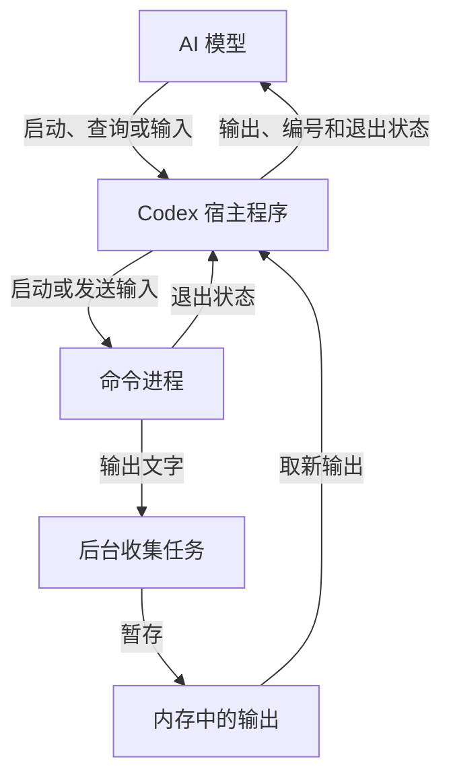

# 命令执行与进程交互

> AI 决定下一步，Codex 启动并持续管理程序。一次工具调用返回后，程序仍可以继续运行；AI 后续带会话编号回来，继续取输出或发送输入。

本文整理讨论结论，并按 Codex 固定提交复核相关实现与已有测试。项目现状参考[工具对比记录](2026-10-21-codex-tools-comparison.md)，同时只读核对本项目的执行实现与工具分派；本次仅整理文档，没有实施工具改造。

本文属于讨论与源码调研记录，按[目录整理规格](../specs/009-project-layout.md)归入 `docs/records/`，沿用同目录“日期＋英文短横线主题”的命名方式，保留原文日期。它尚不是项目改造规格。

## 1. 解决什么问题

有些命令很快结束，启动后等待最终结果就够了。另一些程序需要长时间运行，或者中途需要接收输入，因而需要持续管理。

| 场景 | 实际需要 | 进程会话的作用 |
|---|---|---|
| 长测试、编译 | 运行几分钟，过程中会产生输出 | 先让程序继续跑；Agent 可以做其他工作，再回来查看同一次执行的进度与结果 |
| 本地网站服务 | 服务启动后要保持运行，网页才能访问 | 启动服务后接着验收网页，并保留后续查看输出和停止服务的入口 |
| 交互程序 | 程序询问文件名、是否继续等问题 | 把回答送给原程序，让它继续执行；需要再次回答时继续交互 |

“先返回”改变的是 Agent 何时可以继续工作。它本身不会让测试或编译计算得更快。

## 2. 谁负责什么

| 角色 | 负责的事情 |
|---|---|
| AI 模型 | 决定启动什么、什么时候查询、是否发送输入或请求中断；根据输出决定下一步 |
| Codex 宿主程序 | 接收工具调用，启动进程，保存会话记录，收集输出，返回结果，并管理清理 |
| 命令进程 | 真正执行测试、编译或服务逻辑，产生输出并读取输入 |
| 操作系统 | 实际创建、调度进程，提供输入输出通道，报告进程退出状态 |

AI 不需要持续等待，但 Codex 仍在管理程序。程序也不需要等 AI 再次查看才继续执行。

## 3. 底层如何运行

以下先讲本地执行路径。

### 第一步：启动一份独立运行的程序

Codex 调用进程启动接口，最终由操作系统创建子进程。“子进程”就是由 Codex 启动、单独运行的一份程序。[启动源码][src-spawn]

### 第二步：保留控制信息，给 AI 一个编号

Codex 在内存里保存进程记录，包含进程控制对象、工作目录、运行状态相关信息等，再用会话编号找到这份记录。工具中称为 `session_id`，管理器内部称为 `process_id`；这是 Codex 分配的查找编号，不是操作系统的进程 ID，也不是对话线程 ID。[编号分配][src-id]

编号只是查找入口。一次工具调用返回，并不要求把这份记录删除，也不要求命令进程退出。[会话记录][src-store]、[进程对象][src-process]

### 第三步：后台持续收集输出

Codex 留着一个后台任务，反复读取程序产生的输出，把输出字节先放进内存中的缓冲区，形成工具回复时再转成文字。“缓冲区”就是暂存输出的一块内存。

AI 暂时不查询时，这个任务仍在收集输出。[收集循环][src-collect]

### 第四步：后续按编号继续操作

AI 带会话编号调用工具，Codex 找到原来的进程记录：

- 查询时，取出尚未返回的输出，形成工具回复，再交给 AI；不是每次重新返回完整日志。
- 发送文字时，将文字写入进程的输入通道；该版本需要启动时开启 PTY。
- 程序退出时，记录退出码，处理剩余输出，并按相应策略清理。

“退出码”就是程序结束时给出的状态数字。程序已经结束，并不自动代表业务成功，还要检查退出码、输出和实际结果。[查找会话][src-lookup]、[发送输入][src-input]、[结束处理][src-finish]

## 4. exec_command 与 write_stdin 的分工

| 工具与动作 | 输入 | 实际动作 | 返回 |
|---|---|---|---|
| exec_command 启动命令 | 命令、目录、是否启用交互等 | 启动新的执行，等待一段时间并收集输出 | 当前输出；可继续管理时附会话编号；完成时附退出状态 |
| write_stdin 查询 | 会话编号；chars 为空或省略 | 找到原会话，收集新输出，不发送文字 | 新输出以及运行或结束状态 |
| write_stdin 输入 | 会话编号与非空 chars | 向原程序发送文字，再收集输出；受交互模式限制 | 新输出以及运行或结束状态 |

后续查询和输入操作的是原来那次执行。AI 通过工具回复获得文字，并不直接访问 Codex 的内存。[工具定义][src-spec]、[查询与输入实现][src-input]

可续接时返回的字段是 `session_id`；完成后通常不再返回该字段，而是返回 `exit_code`。管理器找不到该编号时会报错，不会按旧调用记录自动重跑命令；编号释放后可能被复用，不能作为永久标识。[结果与清理][src-finish]、[查找会话][src-lookup]、[编号分配][src-id]

例如，一次测试仍未结束时，Codex 可以先返回会话编号。AI 稍后用这个编号查询这次测试的输出，直到获得最终结果。这里描述的是工作流程，不是本次实际执行记录。

## 5. 普通模式与 PTY：能查看，不一定能输入

PTY 是“伪终端”：让程序认为自己连接着终端，支持终端交互。

| 可续接执行的设置 | 持续运行、后续取输出 | 普通文字输入 |
|---|---|---|
| `tty=false`，或省略 `tty`：普通管道 | 支持 | 该版本关闭 stdin，普通文字输入会被拒绝；Ctrl+C 特例见 §8 |
| `tty=true`：PTY | 支持 | 可以向原程序发送字符；仍受会话状态与权限检查约束 |

因此，普通模式也能支持长测试和服务运行；需要向程序输入文字时，要开启 PTY。

`write_stdin` 按传入内容发送字符，不会自动补换行。程序要求提交一行回答时，需要显式发送换行，例如 `chars: "y\n"`。[发送输入][src-input]

这是 Codex 该提交的具体选择，不是说所有软件的普通管道都不能支持输入。先前提出的“先做普通管道输入、以后再加 PTY”是通用设计建议，不符合该版本现成的输入行为，不能当成 Codex 的做法。[模式定义][src-spec]、[输入限制][src-input]

## 6. 等多久返回，与运行多久必须停止

这两个概念需要分开。该版本将它们放在不同的执行路径中。

| 执行路径 | 时间参数 | 时间到达后的行为 |
|---|---|---|
| 可续接执行 | yield_time_ms：这次工具调用等待多久 | 命令还没结束时先返回，之后可以继续查询 |
| 一次性执行 | timeout_ms：允许命令运行多久 | 超时或取消时终止，不能续接 |

一次性执行的工具定义会移除 `tty`、`yield_time_ms` 和返回的会话编号，公开 `timeout_ms`，默认 10 秒；执行时强制关闭 PTY。超时终止和取消清理由一次性执行路径负责。不能把它说成同一种公开接口同时提供了上述两套时间控制。[执行路径选择][src-lifetime]、[一次性工具定义][src-oneshot]、[超时与取消处理][src-oneshot-run]

可续接路径中，初次执行和后续交互的等待范围也不同：

| 调用 | 省略 `yield_time_ms` 时 | 有效等待范围 |
|---|---|---|
| `exec_command` 初次执行 | 10 秒 | 非 Windows 为 250–30000 毫秒；Windows 为 10000–30000 毫秒 |
| `write_stdin` 发送非空内容 | 250 毫秒 | 250–30000 毫秒 |
| `write_stdin` 空查询 | 5 秒 | 下限 5 秒；上限可配置，默认 300 秒 |

空查询的解析默认值也是 250 毫秒，但管理器会把它提高到 5 秒。上述时间控制本次输出收集的等待，命令结束时可以提前返回；300 秒不是后台程序的最长寿命。[默认值][src-defaults]、[初次执行范围][src-yield]、[后续交互范围][src-write-yield]

默认是否分配 PTY，与是否采用可续接执行，是两件不同的事。tty=false 不等于一次性执行。

## 7. 输出保存在内存，还是磁盘

两处都有，但目的不同。

| 内容 | 存放位置 | 用途 |
|---|---|---|
| 尚未返回的新输出 | Codex 管理的内存缓冲区 | 后续查询时取出，交给 AI |
| 进程的保留输出副本 | 内存 | 保留进程输出记录；源码中名为 transcript，但这个名字不表示它已经落盘 |
| 已成为会话内容的工具结果 | 可随会话记录写入磁盘日志 | 以后回看和恢复对话历史 |

内存中区分 pending（待取输出）和 transcript（保留副本）。查询取走 pending 中的一批输出后，新的输出继续积累到待取部分。[内存结构][src-buffers]、[取走待返回内容][src-drain]

两份内存缓冲各最多保留 1 MiB 的原始输出字节，超过后保留开头与末尾，省略中间内容，并在输出中标明省略字节数。工具回复还可能受到另一层输出预算限制；已从 pending 取走、随后在回复中被截断的内容，不会自动留给下一次查询补发。[容量常量][src-limits]、[头尾保留策略][src-head-tail]、[回复截断][src-response]

工具结果属于允许保存的会话记录，保存时写成 JSONL 文件，也就是“一行一条记录的日志”。实时查询运行中的命令，不依靠重新打开这个日志文件。[保存规则][src-persist-policy]、[写入文件][src-persist-write]

进程管理器属于当前 Codex 会话的服务，创建时使用新的内存存储。据此可推断，保存与恢复对话历史，不会自动恢复本地旧管理器中的进程控制对象；不能据此承诺活进程跨宿主重启重连，也不能承诺全部原始输出完整、永久保存。[会话服务初始化][src-session-manager]、[内存存储][src-store]

## 8. 中断、终止与成功是不同判断

- 仍在运行：返回当前输出，AI 决定继续等、发送输入，还是先做其他工作。
- 已经退出：返回最后输出和退出状态，AI 检查实际结果。例如退出码 7 应如实作为该退出状态返回。
- 请求中断：通过 `write_stdin` 发送 Ctrl+C 对应的控制字符，即 JSON 中的 `"\u0003"`。普通管道模式只对这个单独字符调用中断信号，其他非空输入仍被拒绝；PTY 模式写入控制字符，由终端和程序处理。
- 强制终止：管理器另有内部终止入口，不能把 Ctrl+C 当作无条件强杀的保证。

一次性执行超时另由宿主标记，并以退出码 124 表示；它不属于命令自然退出时的状态。[超时标记][src-timeout-code]

进程记录也不是永久保留：管理器在数量达到 64 时按最近使用等策略清理旧记录，必要时终止仍在运行的旧进程。64 是清理触发阈值，交互锁占用等情况下可能短时超限。正常关闭 Codex 会话时会调用全部进程的终止清理；而中断一个用户轮并不等同于终止所有后台程序，上游也会提示它们可能仍在运行。[清理策略][src-prune]、[会话关闭][src-shutdown]、[用户轮中断提示][src-turn-aborted]

停止程序不会自动撤销它此前已经写入文件等副作用。本项目已有取消与进程回收要求；如何把这些要求用于持续运行的会话，需要在改造规格中明确。[中断实现][src-input]、[内部终止入口][src-terminate]

## 9. 本项目现在有什么，还缺什么

本项目已有同步 `exec_command`：默认执行超时 10 秒，最多 60 秒，stdin 关闭，没有 PTY。只接受 `cmd`、`workdir`、`timeout_ms` 和 `max_output_chars`，结果没有进程会话编号；普通用户轮的工具定义与分派中也没有 `write_stdin`。这些边界已按当前[执行实现](../../src/app/src/exec.rs)、[工具定义](../../src/app/src/prompt.rs)与[分派实现](../../src/app/src/turn.rs)复核。

本次讨论指出的能力缺口是：

1. 命令尚未结束时，返回可继续使用的会话编号。
2. 后续查询同一次执行的新输出及状态。
3. 支持向交互程序发送输入。
4. 为持续运行的进程定义中断、终止和回收方式。
5. 将长任务与服务运行的生命周期，同现有执行超时、取消和权限契约衔接。

这些能力增加的是对持续工作过程的管理。工作目录本身仍不构成沙箱，已有权限约束也需要继续成立。

## 10. 改造前尚未决定的边界

以下是本项目后续收敛规格需要回答的问题。前文记录的 Codex 行为只作对照，本次没有将它们直接定为本项目的实现要求：

- 会话仅跨工具调用保留，还是允许跨用户轮保留？宿主退出时怎样处理？
- 原有超时契约怎样与长测试、持续运行的服务兼容？
- 用户取消一轮任务时，应停止哪些进程？需要保留的服务怎样明确归属？
- 同时保留多少进程、多少输出，达到上限时如何处理？
- 第一版的平台支持与真实验收范围是什么？

现阶段是讨论总结。原有 [003 执行契约](../specs/003-exec-command.md)与 [006 调用循环契约](../specs/006-tool-call-loop.md)是后续规格收敛的入口；尚未形成新的已批准实现规格。

## 源码依据

固定仓库：openai/codex。固定提交：`d138398cef7d49e46fe33f1d0ddbd2ca0ed16aa4`。以上结论不自动代表其他版本。

核查范围：工具定义及处理器、进程管理器、本地启动、输出缓冲、一次性执行、会话关闭与日志保存。另阅读该提交的[跨调用保留及退出状态测试][src-tests]、[等待范围及清理策略测试][src-manager-tests]作为静态交叉依据；本次没有构建或运行 Codex 上游测试，也没有进行跨宿主重启或 Windows 运行验证。[官方说明](https://developers.openai.com/cookbook/examples/gpt-5/codex_prompting_guide#shell_command)用于核对两项工具的基本分工，具体参数与边界以上述固定提交为准。

本次整理验证：7 个相对链接、30 个固定提交源码引用的路径与行号检查通过；规范与需求两轴审查各 0 项问题。仅改动本文，原有十个编号章节保留，另外两份未提交文档哈希不变。本项目在仓库根执行 `cargo check --locked --offline && cargo test --workspace --locked --offline --no-fail-fast`，退出码 0；50 个测试目标合计 3045 通过、0 失败、3 项既有忽略、0 过滤、0 未运行。本次没有新增运行行为，不新增 Rust 用例，也不扩展实施规格。

[src-spawn]: https://github.com/openai/codex/blob/d138398cef7d49e46fe33f1d0ddbd2ca0ed16aa4/codex-rs/utils/pty/src/child_command.rs#L338
[src-store]: https://github.com/openai/codex/blob/d138398cef7d49e46fe33f1d0ddbd2ca0ed16aa4/codex-rs/core/src/unified_exec/mod.rs#L149-L152
[src-process]: https://github.com/openai/codex/blob/d138398cef7d49e46fe33f1d0ddbd2ca0ed16aa4/codex-rs/core/src/unified_exec/process.rs#L97-L114
[src-collect]: https://github.com/openai/codex/blob/d138398cef7d49e46fe33f1d0ddbd2ca0ed16aa4/codex-rs/core/src/unified_exec/process.rs#L656-L690
[src-lookup]: https://github.com/openai/codex/blob/d138398cef7d49e46fe33f1d0ddbd2ca0ed16aa4/codex-rs/core/src/unified_exec/process_manager.rs#L1188-L1218
[src-input]: https://github.com/openai/codex/blob/d138398cef7d49e46fe33f1d0ddbd2ca0ed16aa4/codex-rs/core/src/unified_exec/process_manager.rs#L1002-L1027
[src-finish]: https://github.com/openai/codex/blob/d138398cef7d49e46fe33f1d0ddbd2ca0ed16aa4/codex-rs/core/src/unified_exec/process_manager.rs#L1075-L1118
[src-spec]: https://github.com/openai/codex/blob/d138398cef7d49e46fe33f1d0ddbd2ca0ed16aa4/codex-rs/core/src/tools/handlers/shell_spec.rs#L22-L151
[src-lifetime]: https://github.com/openai/codex/blob/d138398cef7d49e46fe33f1d0ddbd2ca0ed16aa4/codex-rs/core/src/tools/handlers/unified_exec/exec_command.rs#L293-L301
[src-oneshot]: https://github.com/openai/codex/blob/d138398cef7d49e46fe33f1d0ddbd2ca0ed16aa4/codex-rs/core/src/tools/handlers/unified_exec/exec_command.rs#L463-L489
[src-buffers]: https://github.com/openai/codex/blob/d138398cef7d49e46fe33f1d0ddbd2ca0ed16aa4/codex-rs/core/src/unified_exec/process.rs#L42-L60
[src-drain]: https://github.com/openai/codex/blob/d138398cef7d49e46fe33f1d0ddbd2ca0ed16aa4/codex-rs/core/src/unified_exec/process_manager.rs#L1634-L1641
[src-persist-policy]: https://github.com/openai/codex/blob/d138398cef7d49e46fe33f1d0ddbd2ca0ed16aa4/codex-rs/rollout/src/policy.rs#L80-L98
[src-persist-write]: https://github.com/openai/codex/blob/d138398cef7d49e46fe33f1d0ddbd2ca0ed16aa4/codex-rs/rollout/src/recorder.rs#L2141-L2145
[src-terminate]: https://github.com/openai/codex/blob/d138398cef7d49e46fe33f1d0ddbd2ca0ed16aa4/codex-rs/core/src/unified_exec/process_manager.rs#L1870-L1883
[src-id]: https://github.com/openai/codex/blob/d138398cef7d49e46fe33f1d0ddbd2ca0ed16aa4/codex-rs/core/src/unified_exec/process_manager.rs#L452-L475
[src-defaults]: https://github.com/openai/codex/blob/d138398cef7d49e46fe33f1d0ddbd2ca0ed16aa4/codex-rs/core/src/tools/handlers/unified_exec.rs#L60-L70
[src-yield]: https://github.com/openai/codex/blob/d138398cef7d49e46fe33f1d0ddbd2ca0ed16aa4/codex-rs/core/src/unified_exec/mod.rs#L212-L219
[src-write-yield]: https://github.com/openai/codex/blob/d138398cef7d49e46fe33f1d0ddbd2ca0ed16aa4/codex-rs/core/src/unified_exec/process_manager.rs#L1029-L1038
[src-oneshot-run]: https://github.com/openai/codex/blob/d138398cef7d49e46fe33f1d0ddbd2ca0ed16aa4/codex-rs/core/src/unified_exec/oneshot.rs#L41-L123
[src-limits]: https://github.com/openai/codex/blob/d138398cef7d49e46fe33f1d0ddbd2ca0ed16aa4/codex-rs/core/src/unified_exec/mod.rs#L73-L80
[src-head-tail]: https://github.com/openai/codex/blob/d138398cef7d49e46fe33f1d0ddbd2ca0ed16aa4/codex-rs/core/src/unified_exec/head_tail_buffer.rs#L5-L18
[src-response]: https://github.com/openai/codex/blob/d138398cef7d49e46fe33f1d0ddbd2ca0ed16aa4/codex-rs/core/src/tools/context.rs#L481-L534
[src-session-manager]: https://github.com/openai/codex/blob/d138398cef7d49e46fe33f1d0ddbd2ca0ed16aa4/codex-rs/core/src/session/session.rs#L1731-L1738
[src-timeout-code]: https://github.com/openai/codex/blob/d138398cef7d49e46fe33f1d0ddbd2ca0ed16aa4/codex-rs/core/src/unified_exec/process.rs#L214-L230
[src-prune]: https://github.com/openai/codex/blob/d138398cef7d49e46fe33f1d0ddbd2ca0ed16aa4/codex-rs/core/src/unified_exec/process_manager.rs#L1750-L1839
[src-shutdown]: https://github.com/openai/codex/blob/d138398cef7d49e46fe33f1d0ddbd2ca0ed16aa4/codex-rs/core/src/session/handlers.rs#L299-L317
[src-turn-aborted]: https://github.com/openai/codex/blob/d138398cef7d49e46fe33f1d0ddbd2ca0ed16aa4/codex-rs/core/src/context/turn_aborted.rs#L11-L13
[src-tests]: https://github.com/openai/codex/blob/d138398cef7d49e46fe33f1d0ddbd2ca0ed16aa4/codex-rs/core/src/unified_exec/mod_tests.rs
[src-manager-tests]: https://github.com/openai/codex/blob/d138398cef7d49e46fe33f1d0ddbd2ca0ed16aa4/codex-rs/core/src/unified_exec/process_manager_tests.rs

