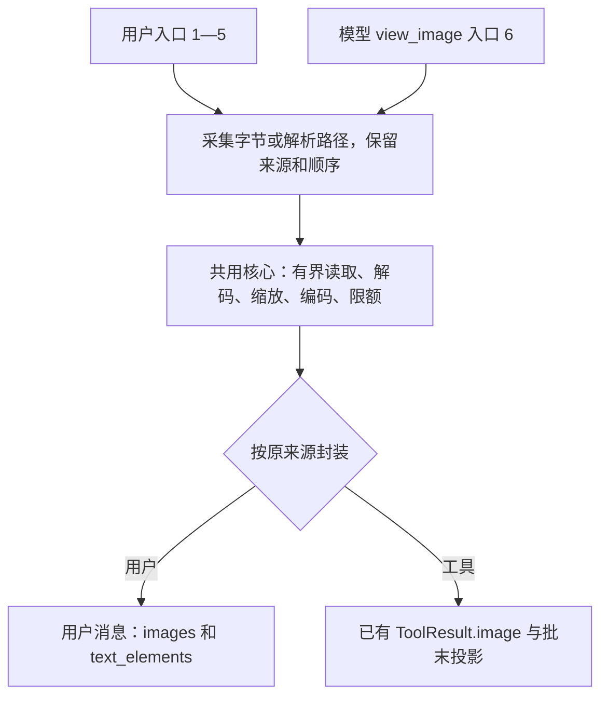

# 规格：CLI 用户附图

> 状态：**已实施（2026-10-23 交付候选，待批准）**：五种用户入口（1 Ctrl+V 剪贴板按键／2 `@` 搜索选图／3 拖入·4 路径粘贴共用／5 `-i` 启动参数）＋完整附件链路（提交准备、队列暂停与恢复、保存/记忆过滤）已实现并验证；A01–A25 除宿主依赖部分外全部有证据（明细见[实施记录](../records/2026-10-23-020-cli-image-input-impl.md)）；H01–H03 待宿主条件。
> 日期：2026-10-23。
> 当前代码基线：本轮重新核实的本地 `main@761545407cffa23b25f4fee96e37f7cb52248ec7`，已包含 019 工具提交；早先观察到的 `f842d39` 不作为本任务基线。
> 任务分支：`feat/020-cli-image-input`；合并目标：本地 `main`；实际准备结果见[准备记录](../records/2026-10-23-020-cli-image-input-spec-prep.md)。不提交、合并、推送或删除分支。
> 任务工作树：`/tmp/terminal-chat-020-cli-image-input`。原 `/workspace` 保持其 main 与外部改动；新任务工作树仅放本次四份文档。后续 `/goal` 应明确使用任务工作树，不在原目录混合执行。
> 来源：[019 §9 关联索引](019-view-image.md#9-cli-图片输入补充讨论2026-10-23)、[调研 §5–§7](../records/2026-10-23-view-image-plan-research.md#5-cli-图片输入讨论落盘2026-10-23)、[019 原实施证据](../records/2026-10-23-view-image-impl.md)。本文是后续用户附图的独立契约，原实施证据保留。
> Codex 固定参考：`d138398cef7d49e46fe33f1d0ddbd2ca0ed16aa4`。本规格采用仓库固定五节结构；本轮只改文档及准备普通任务分支，不执行 `/goal` 或功能门禁。

## 1. 目标 & I/O

让用户通过终端入口将真实图片直接随用户消息发送，复用 019 已有图片准备核心；保留“多个入口 → 共用核心 → 用户附件／工具结果两个出口”。用户选图不经过 `view_image` 工具分派，也不新增工具。

### 1.1 六种入口的现状与执行范围

“020 实施项”指后续获下发的功能任务，本轮尚不实施。前五项都纳入契约；宿主能力的成功验收另列条件，不能以模拟替代。

| 入口 | 当前基线现状 | 020 实施项与环境限制 |
|---|---|---|
| 1. 复制图片后粘贴 | 保留部分剪贴板读取／附件代码，普通驱动尚未贯通图片提交 | 接通普通聊天的图片粘贴动作、PNG 采集和附件提交；复用 Codex 原生／WSL 可用路径。Docker 不能凭终端输入自动获得 Windows 剪贴板，真实桥接可达性按 H01 验证；无能力时明确提示并保留草稿 |
| 2. `@` 搜索选图 | 文件选择处理曾被裁剪，尚未端到端附图 | 恢复文件候选选择与有效图片附件转换；提交时直接附图。仅写 `@路径` 文本不等于建立了附件；选择失败不得显示已附图 |
| 3. 拖入图片文件 | 宿主可能将文件转成路径，已有部分粘贴识别代码 | 共用入口 4；只处理实际收到的路径，不新增拖拽传输协议。宿主是否提供路径按 H02 验证 |
| 4. 粘贴图片路径 | 输入框保留规范化／标记能力，驱动仍只传文本 | 接通单个合法路径的真实读取和附件传递；支持空格、中文、引号、单路径 shell 转义及本地 `file://`，不按空格猜拆多个文件 |
| 5. `-i`／`--image` | 还没有用户图片启动参数链路 | 接通启动图片至首个用户轮；支持逗号分隔和重复参数。管道文字与首条可提交输入合并，EOF 无文字时允许纯图一次；TUI 就绪且保护性输入结束后提交初始图片一次。退出／命令优先，不因附图绕过既有退出语义；不新增位置参数提示词、`codex exec` 子命令或其他启动配置 |
| 6. 模型 `view_image` | 已在当前 main 中实现，证据见 019 | 复用核心并做必要回归；不重新实施、不扩大参数面、不改变工具调用次数、结果配对或原持久化语义 |

### 1.2 输入、输出与实现边界

- 输入是完整用户消息：原文字、按附加顺序保存的图片路径／附件、结构化 `TextElement`。输入框、宿主、队列和历史之间不得退回只传 `String` 而丢附件。
- 输出是可解码的模型图片内容、对应的用户历史及可恢复的 UI 附件；图片只属于原用户消息。纯图片消息有效，不要求添加虚构说明文字。
- 本轮后续功能面包含附图、删图、编号、排队／回填、取消与失败恢复、保存恢复、记忆过滤和启动参数；截图拍摄、OCR、图像生成、远程 URL 下载、`original`、位图终端预览和新的宿主常驻服务均不引入。
- 复用现有宿主接口／Codex 剪贴板适配；不为 Docker 增加未授权的网络端口、宿主服务、全盘挂载或权限。若缺桥接，交付必须保留真实宿主成功验收缺口，不能将入口接线成功称为 Windows 剪贴板成功。

## 2. 边界 & 风险

### 2.1 已确认规则

| 契约 | 固定行为 |
|---|---|
| 复用核心 | 固定 Codex 提交；优先调用 019 现有文件检查、有界读取、`prepare_image`、格式编码及 API 检查，只开放／提取必要函数，不另写六套实现 |
| 排队与冻结 | 队列保存完整消息和附件路径，入队不读取并冻结全部图片。出队正式提交时读取、校验、准备，再将准备后的真实图片入历史并持久化。排队期间修改源图，采用正式提交时版本；入史后修改／删除源图，续请求和恢复仍用已存内容 |
| 预算 | 不新增全队列图片字节上限，不提前给全部队列常驻 base64。沿用 019：输入 20 MiB、宽高各 16384、解码器分配预算 64 MiB、准备后单图 4 MiB；最终 JSON 含所有图片、历史、文本、tools、model 和参数，仍受原 10 MiB 限制。上游远程单次 32 MiB 不是本地队列预算 |
| 准备策略 | 沿用 HIGH_DETAIL（最大边 2048、32 像素 patch、最多 2500 patches）、PNG/JPEG/WebP 源字节／必要元数据处理及 GIF 转静态 PNG；不扩大格式，不自动反复降质 |
| 临时 PNG | 沿用 keep 保留行为；移除附件、取消、发送后及退出都不新增自动删除。keep 前失败按 tempfile 生命周期清理；用户原图不删除；队列退出后不另建未发送消息持久化 |
| 能力和权限 | 沿用每轮模型图片能力快照；未知／仅 text 时不发送图片，能力拒绝先于正式文件打开。普通文件、FIFO／设备检查、宿主既有读权限、URL 限制和错误脱敏复用 019；不使用 shell 解析或打开图片 |

### 2.2 消息与持久化

保留 V1 meta、`HistoryMessage.role/content/user_input_event`。只为普通用户消息映射 Codex 的两个字段：

| 字段 | 表征、对应关系与校验 |
|---|---|
| `images` | `Option<Vec<String>>`，每项为准备后的真实本地图片 data URL；缺省 None，无图不序列化。数组顺序就是附件编号顺序，首版 detail 固定 high；纯图允许原文字为空 |
| `text_elements` | `Vec<codex_protocol::user_input::TextElement>`，复用既有 `byte_range/placeholder`；缺省空且空时省略。区间为 `content` 的有效 UTF-8 字节边界；结构化 `[Image #N]` 指向 `images[N-1]`。每个结构化图片标记恰有对应图片，不得越界、重复绑定或遗留失效标记；纯图无正文标记时按图片数组生成展示编号 |

- 手写 `[Image #1]` 是普通文字，没有结构化元素和图片载荷就不能变成附件；添加同名／同内容图片不擅自去重。删除真实附件标记同步移除对应图片并重编号；编辑、粘贴扩展和回填后重算元素位置，不能发送已删除的隐藏图片。
- 旧无图会话与纯文本请求保持原形状；旧程序读取新字段后重存会丢附件，明确此降级，不宣称无损。缺载荷的旧标记只显示文字，不冒称已经附图。
- 恢复只用保存的图片内容；路径是输入框／队列中的读取来源，不能作为恢复时重新加载的依据。非法类型、base64、MIME、远程 URL、超限图片或非法标记关系按 007 坏行与既有配对修复规则处理，不为损坏记录发网络请求。
- 用户消息的文字、载荷和标记同一历史行保存，沿用 64 MiB 行上限、追加、锁和原子快照；不创建独立附件数据库或服务。
- 提炼前同时剥除用户 `images` 与工具 `image`；不把 base64 写入提炼输入、日志或摘要。单条超过 1 MiB 的记录仍整条跳过，总扫描预算仍 8 MiB；不为新字段放宽预算。助手对图片的正常文字回复仍按既有文本提炼规则处理。

请求投影固定为：无图消息仍用原字符串 `content`；有图消息在**同一条原用户消息**中使用 text 与按 `images` 顺序排列的 `image_url` 部件，detail 固定 high。原文字保留，无文字时可省略 text 部件；`text_elements` 是 UI 元数据，不发送给模型。不为用户附图额外伪造另一条用户消息或工具结果。

例如原文字为 `[Image #1] 请检查界面` 时，元素 `{byte_range:{start:0,end:10},placeholder:"[Image #1]"}` 对应 `images[0]`；该 UTF-8 字节区间只覆盖标记。保存的 data URL 与本次发送的准备后图片内容相同，不能在恢复时重新编码原路径来替换它。

### 2.3 草稿、队列和历史的状态契约

记 `D0` 为本次提交消息，`Dnew` 为准备／任务运行期间用户新写的草稿，`Q` 为其余待发队列，`H` 为已接受历史。准备工作在不阻塞终端的有界执行路径完成；提交标识区分迟到结果，不引入无限准备任务。

| 事件边界 | 文字、附件、草稿、队列与历史的最终状态 |
|---|---|
| 附加／删除／编辑 | 仅改变当前草稿及附件；Q/H 不变，不发请求。编号与实际附件同步，失败的选择或路径识别不生成成功标记 |
| 运行中入队 | 完整 D0 加入队尾，只移走这份已提交草稿；Q 中保留路径和标记，H 不新增该消息，不提前读取源图；后续 Dnew 独立保留 |
| 出队准备成功并入史 | 该消息从待发状态恰一次转入 H，保存准备后图片，随后按既有流程请求模型；Dnew 不被旧提交回执清空或覆盖，其余 Q 按顺序保留 |
| 入史前能力拒绝、缺失／坏图、准备错误或取消 | 本次消息不进入 H、不发本次模型请求。被取出的 D0 从准备态恢复到草稿，已有 Dnew 时按 Codex 顺序合并 D0 后接 Dnew 并重编号；不是再复制一份到 Q。其余 Q 保留并暂停自动发送，等待用户处理／重新提交恢复稿；不得覆盖新草稿或自动反复重试 |
| 入史后的请求体超限、提供方错误或取消 | 已接受消息及图片在 H 保留恰一份；不自动回滚、恢复同一旧稿、重新入队或重发。Dnew 保留，剩余 Q 暂停自动发送，用户可经历史回填主动重试。体积超限零 HTTP；已发出的请求取消沿用现有迟到结果丢弃规则，不谎称远端未处理 |
| 准备完成通知迟到 | 被取消／替换的提交结果不入史、不发请求、不改 Dnew/Q。一次取消不能残留可再次提交的旧准备结果 |
| 退出 | 沿用当前终端和进程收尾；D/Q 不新增持久化，已接受 H 排空按既有契约处理，keep 后 PNG 保留。TUI Esc 取消、Ctrl+C 退出和普通 CLI 退出语义不改 |

### 2.4 工具、问询与外部边界

- 用户附图直接进入用户消息，不调用 `view_image`、不伪造 assistant/tool 记录、不增加工具或额外看图请求。工具图片仍保留 `tool_call_id` 并按原完整批次投影。
- 新用户输入只按现有后续轮队列提交，不插入正在收集的 tool 结果之间。018 的专用回答通道、真实晚到回答在批末的入史顺序及问询来源标记保持；不得把图片附件当成问询回答或用普通队列代替专用回答。
- 普通问询的 plain_text 输入关闭图片附加和文件选择；文字粘贴、选项和取消仍正常。内部记忆合并轮的受限工具面不扩大。
- 图片和图中文字属于分析材料；文件名、路径或错误文本进入终端前过滤显示副本，不能注入控制序列或提高指令权限。模型请求载荷和关联 ID 不因显示过滤被改写。
- 本地 `file://` 只转文件路径；不下载 http(s) 图片，不转发凭证到其他地址。继续使用原 origin／重定向限制和 data URL 错误遮蔽。

## 3. 关键判断（为什么）

### 3.1 复用路径与最小修改面

核心继续放在 app；TUI 仅采集和展示，不反向依赖 app。启动、管道、交互和恢复都复用同一用户消息提交边界；现有 019 的行为已交付，不重做工具首版。

| 固定 Codex 源码 | 直接复用／本地适配 |
|---|---|
| [utils/image/src/lib.rs](https://github.com/openai/codex/blob/d138398cef7d49e46fe33f1d0ddbd2ca0ed16aa4/codex-rs/utils/image/src/lib.rs)、[core/src/image_preparation.rs](https://github.com/openai/codex/blob/d138398cef7d49e46fe33f1d0ddbd2ca0ed16aa4/codex-rs/core/src/image_preparation.rs) | 本地 [view_image.rs](../../src/app/src/view_image.rs) 已有处理函数优先复用；不引入缓存／上传服务 |
| [attachment_state.rs](https://github.com/openai/codex/blob/d138398cef7d49e46fe33f1d0ddbd2ca0ed16aa4/codex-rs/tui/src/bottom_pane/chat_composer/attachment_state.rs)、[chat_composer.rs](https://github.com/openai/codex/blob/d138398cef7d49e46fe33f1d0ddbd2ca0ed16aa4/codex-rs/tui/src/bottom_pane/chat_composer.rs) | 复用编号、删除、外部编辑、`@` 选图；只恢复已裁剪且本功能必需入口 |
| [user_messages.rs](https://github.com/openai/codex/blob/d138398cef7d49e46fe33f1d0ddbd2ca0ed16aa4/codex-rs/tui/src/chatwidget/user_messages.rs)、[input_queue.rs](https://github.com/openai/codex/blob/d138398cef7d49e46fe33f1d0ddbd2ca0ed16aa4/codex-rs/tui/src/chatwidget/input_queue.rs)、[input_restore.rs](https://github.com/openai/codex/blob/d138398cef7d49e46fe33f1d0ddbd2ca0ed16aa4/codex-rs/tui/src/chatwidget/input_restore.rs) | 完整消息排队与失败稿合并，保留原源和附件；不照搬 steer 调度 |
| [protocol/src/protocol.rs](https://github.com/openai/codex/blob/d138398cef7d49e46fe33f1d0ddbd2ca0ed16aa4/codex-rs/protocol/src/protocol.rs)、[protocol/src/user_input.rs](https://github.com/openai/codex/blob/d138398cef7d49e46fe33f1d0ddbd2ca0ed16aa4/codex-rs/protocol/src/user_input.rs) | 复用 images／TextElement 字段语义，映射本地 V1；固定 high 不加 detail 数组或 file ID 服务 |
| [clipboard_paste.rs](https://github.com/openai/codex/blob/d138398cef7d49e46fe33f1d0ddbd2ca0ed16aa4/codex-rs/tui/src/clipboard_paste.rs)、[shared_options.rs](https://github.com/openai/codex/blob/d138398cef7d49e46fe33f1d0ddbd2ca0ed16aa4/codex-rs/utils/cli/src/shared_options.rs) | 采集、规范化、keep 和图片参数；本地只带入必要参数及依赖，不抄全部 CLI 配置 |
| [models.rs](https://github.com/openai/codex/blob/d138398cef7d49e46fe33f1d0ddbd2ca0ed16aa4/codex-rs/protocol/src/models.rs)、[session/mod.rs](https://github.com/openai/codex/blob/d138398cef7d49e46fe33f1d0ddbd2ca0ed16aa4/codex-rs/core/src/session/mod.rs) | 正式提交时读图、准备后入史；远程客户端快照不是本地入队规则 |

主要落点是 `main.rs/tui_host.rs/chat_driver.rs` 的完整消息通道、输入框已有附件／搜索入口、`prompt.rs/session.rs/memory/rollout_input.rs` 的用户附件投影／读写／过滤，以及图片准备核心的必要复用接口。只为此范围更新配置说明和相应测试，不重构无关代码，不提前升级依赖。

### 3.2 本地适配的依据

1. Chat Completions 的用户消息可携带 image_url；工具图片的既有协议适配仍由 019 承担。两种来源共享图片处理但不共享历史归属。
2. 队列保存路径而非提前冻结，直接采用 Codex 本地行为；只在入史后保证图片内容固定。测试必须分别证明入队后改图和入史后改图这两个边界。
3. 用户附件与标记跟随同一消息，避免普通字符串队列和原文标记不同步；恢复失败稿使用上游合并顺序，保护后来输入的草稿。
4. 验证以真实请求、文件和屏幕为准。Mock 只放在 HTTP、剪贴板和受控调度等系统边界，不能替换图片解码、状态转移或历史投影。

## 4. 坑记录

- 本轮最初观察到 `feat/019-view-image@f842d39` 及未提交候选；核对期间外部 Git 状态前进到 `main@761545407cffa23b25f4fee96e37f7cb52248ec7`，该提交已包含 019。后者经重新只读核实后才是本任务基线；本轮没有执行这个提交、合并或原分支清理。
- 019 实施记录的 3229/0/0 是既有证据，不是本轮或 020 的功能测试结论；020 全部功能行待验证。原 019 证据及调研 §5–§7 不改写。
- 三份既有无关未跟踪记录保留，不暂存、不随新任务打包。分支创建前后核对原字节；后续也不得使用无范围的 `git add .` 收入这些记录。
- 当前输入驱动／排队仍为文本接口；有附件辅助函数不等于端到端用户附图。旧程序重存丢图、提炼单条超限整行跳过、keep 后文件留存均是明确行为，不为让验收好看而隐去。
- 现有同步 turn 桥和 TUI 按键分工保留；准备取消只在有界解码检查点完成，不宣称能瞬间打断解码器。宿主 Clipboard／Windows／Docker 不可达要报告，不能用内核标识或模拟屏幕推断可用。
- `CARGO_TARGET_DIR` 的隔离要求按 AGENTS.md；本轮无构建。未来在副本或工作树执行 Cargo 时要显式使用其专用 target-dir，不能污染共享产物。
- 实施轮补充（2026-10-23，证据见实施记录）：① 给 `HistoryMessage` 加字段的机械脚本再次落入 019 记录的"模式位置误插"坑（`images: None` 在 matches! 中是匹配守卫，静默收窄行为）——清理判定必须先剥候选行再判构造，且需栈式括号配对与残片复查；② TUI PTY 时序：bracketed paste 后 120ms 抑制窗与 8ms 突发窗都会把 Enter 吞成换行（母本行为），测试需 sleep＋分离发送；③ 审查发现并被修复的三处：拒绝/失败后队列未暂停（§2.3）、拒绝不回收 transcript 用户 cell、准备期取消标志被复位吞掉（A12）；④ `@` 选图依赖 008 整层裁剪的弹窗体系，恢复＝重建宿主 glue，按重建排期。

## 5. 预测 → 实测（验收清单）

### 5.1 测试边界与等级

本规格用下表明确定义 L1/L2/L3，仓库没有另一个已核实的同名测试任务；等级是测试范围，不是虚构的脚本命令。Supervisor 复核本规格后，将这些公开边界作为后续 TDD 的依据。

| 等级 | 范围、观察边界及局限 |
|---|---|
| L1 组件／静态 | 公共消息输入输出、附件编辑、路径与字段校验、图片准备输入输出、取消检查点；类型检查支持该层。检查真实结果，不直接钉住私有函数写法；不能代替跨模块与宿主证明 |
| L2 集成 | 真实驱动／宿主／队列／投影／API 与本地固定 HTTP、真实图片编解码及临时文件、V1 保存恢复、记忆过滤、018 回答顺序。检查请求计数、可解码图片和历史副作用；剪贴板边界替身不能证明真实宿主粘贴 |
| L3 系统 | 真实 CLI 进程和 TUI PTY＋屏幕解析，检查输入、屏幕、退出码、文件、网络及队列结果；宿主项目按 H01–H03 另验。目标终端宿主行为不能仅凭模拟屏幕通过 |

### 5.2 场景 → 预期结果、状态、副作用 → 验证方式

本轮不执行功能验收。表中每项均为 **待验证**，不借用 019 的历史通过结果。

| ID／场景 | 预期结果、最终状态及副作用 | 验证方式 | 状态 |
|---|---|---|---|
| A01 普通聊天粘贴图片 | 固定剪贴板边界返回 PNG 后，草稿出现真实附件；提交直接携图，不产生 view_image 调用；普通文字不丢 | L2 边界替身＋真实核心；L3 PTY；真实宿主另见 H01 | 待验证 |
| A02 `@` 选图 | 有效候选转附件，文字路径 token 与标记不重复；无效图片保留可恢复输入并提示，不伪称已附图 | L1/L3 真实选择事件和屏幕，HTTP 附件交叉核对 | 待验证 |
| A03 路径粘贴／拖入 | 空格、中文、引号、转义、file URL 解析正确，原图不被修改；普通文字或多路径文本不被误吞 | L1 固定路径（既有 normalize 单测）；L2 生产入口实测（引号＋空格＋中文、file://、shell 转义→附件＝解码路径、原图字节不变、多路径/普通文本负例——见实施记录 §10）；L3 bracketed paste（S100/S112）；宿主拖入另见 H02 | **已验证（本地）** |
| A04 启动 `-i`／`--image` | 重复参数／多图形成首轮的有序附件；管道首条文字合并或 EOF 纯图恰一次，TUI 初始图不重复；退出／命令不变 | L3 启动真实进程，检查请求数、图片数组、回显及退出码 | 待验证 |
| A05 纯图与纯文本 | 空文字有图可提交；空文字无图仍不提交；纯文本请求和 V1 行不增加空图片字段 | L1/L2 语义及黄金 JSON；L3 Enter／EOF | 待验证 |
| A06 多图及同名／重复图 | 编号和请求数组按附加顺序一致，不因同名或相同内容自动去重；原文字保留 | L2 解码每张请求图验证固定像素／字节；L3 标签与屏幕 | 待验证 |
| A07 删除、清空、编辑与重编号 | 删除图 1 后图 2 编为 1；被删图片字节不再发送；草稿编辑后位置与图片一一对应，Q/H 不变 | L1/L3 实际按键／编辑；L2 解码最终请求验证缺失项 | 待验证 |
| A08 手写附件标记 | 仅输入 `[Image #1]` 不建立附件、不读文件、不附图；失效结构化标记不能隐藏上传 | L1/L2 构造文字和结构化元素的对照，检查实际请求 | 待验证 |
| A09 运行中入队及源图变化 | 队列只记录完整消息与路径；入队不读图，改图后出队采用新版本；Dnew 保留，FIFO 顺序不变 | L2/L3 受控前轮响应屏障，入队后改写固定文件再放行 | 待验证 |
| A10 出队时源图删除／坏图 | 该消息不入 H、零本次模型请求；恢复到 D，已有新草稿则按 D0＋Dnew 合并并重编号；Q 剩余项保留且暂停，源文件不被写入 | L2/L3 先入队后删图／替换无效字节，检查 D/Q/H 和请求计数 | 待验证 |
| A11 模型能力未知／仅 text | 能力拒绝先于正式读图，零请求，不自动转纯文本；D0 和附件可恢复，Q 保留／暂停，H 无该用户消息 | L2 能力快照对照＋真实不可读路径；L3 拒绝后切换重试 | 待验证 |
| A12 准备期间取消、新草稿与迟到结果 | 入史前取消恢复整条消息，Dnew 不丢；Q 暂停，H 不增，本次零请求；迟到完成不能发图或改新草稿，准备任务有界 | L2 受控准备检查点；L3 Esc＋新输入，检查屏幕／历史／请求 | 待验证 |
| A13 入史后取消 | H 保留用户图一次，不自动重排或重发；Dnew 留存，Q 暂停；已发请求的迟到结果依既有规则丢弃 | L2/L3 本地 HTTP 接收／放行屏障，区分发送前后取消 | 待验证 |
| A14 最终请求超 10 MiB | 附件、全历史和参数合并计量，零 HTTP；按已入史契约保留消息一次，Dnew 不变，Q 暂停，不自动降质重试 | L2/L3 固定噪声夹具及临界值，检查网络计数和 H/Q | 待验证 |
| A15 提供方拒绝／回显载荷 | 不重试、不暗中转文本；H 保留一次，Dnew 与剩余 Q 不丢；错误和日志无 base64／凭证 | L2 固定 HTTP 4xx 响应；L3 stdout/stderr 与屏幕 | 待验证 |
| A16 实际请求图片内容 | PNG/JPEG/WebP/GIF 走真实核心，图片可 base64 解码并重新打开，MIME、尺寸、代表像素／源字节符合独立固定期望 | L2 mock 接收真实 JSON，使用真实 image 解码；继承 019 缩放夹具 | 待验证 |
| A17 保存恢复与源图删除 | images／元素与正文同一行保存，auto 与 `/save` 均可恢复；删源图后续请求仍是已存内容，不重读／重放 | L2/L3 文件删除后 `/resume`，解码请求图并核对字节与历史数 | 待验证 |
| A18 损坏附件历史 | 类型、范围、编号、MIME、base64、远程 URL、资源超限按坏行处理；meta/锁/工具配对规则不漂移，不访问 URL 或源路径 | L1/L2 固定损坏 JSONL 和真实加载器，核对跳过／修复与零外部交互 | 待验证 |
| A19 旧会话及降级 | 缺新字段的旧会话正常；旧形状解析器重存会丢新字段，明确降级；纯标记不能冒称有图片，普通无图请求不变 | L2 历史夹具双向读写与黄金结果；不放宽旧断言 | 待验证 |
| A20 记忆过滤 | 用户与工具图片载荷均不进提炼／Markdown／摘要；文字按原规则保留，超 1 MiB 行整行跳过，总预算 8 MiB 不变 | L2 真实保存记录→读取→过滤→本地提炼边界，检查序列化内容 | 待验证 |
| A21 普通问询回答边界 | 回答窗口不接图片、不建附件；文字／选项／取消及独立回答通道原样，聊天 D/Q 不被误当答案 | L2/L3 开启真实问询窗口，触发图片粘贴与普通文字／选项回送 | 待验证 |
| A22 工具批次及晚到回答顺序 | 用户附图排为后续轮；当前批全部 tool 结果仍配对后才接晚到回答／后续用户图，无重复附件或伪造工具调用 | L2/L3 混合工具批＋018 专用回执屏障，核对完整真实请求／历史序列 | 待验证 |
| A23 文件／解析与输入安全 | 非图片、FIFO、设备、不可读文件有界拒绝；限额前后边界有效，无 shell 展开、目录写入或额外权限；路径控制字符无终端副作用 | L1/L2 真实临时文件和受控恶意夹具；L3 原始字节＋解析屏幕交叉检查 | 待验证 |
| A24 keep 与退出 | keep 后 PNG 在删附件、取消、发送或退出后仍存在；keep 前失败由 tempfile 清理；用户原图原字节不变，退出不持久化未发 Q | L2 独立验证：生产写入路径 `write_png_keep_temp`（唯一实现）keep 后文件持续存在、字节一致可解码、无自动清理；未 keep 的同形 tempfile 丢弃即清理（生命周期契约）；用户原图不变由 A03 生产入口实测；退出不持久化未发 Q 由 S110/S103 队列语义覆盖——keep 成功路径的入口（真实剪贴板读取）依赖 H01 | **已验证（本地写入路径）＋H01 依赖部分** |
| A25 工具与纯文本回归 | 019 工具的声明、能力分派、结果、保存与批末图片投影不变；无新工具；未触及路径的原文本／问询回归仍成立 | L2 既有回归＋黄金请求；最终完整 workspace 验证 | 待验证 |
| H01 Windows／Docker 真剪贴板 | 仅在授权的专用测试桌面／账户、终端、容器与现有桥接／互操作可达时，实际复制固定 PNG 后附图成功；不可达须清楚失败并保留草稿，不标成功 | L3 真实宿主剪贴板→终端→Docker→请求；边界 mock 仅算 A01，不代替此项 | 待验证（需宿主条件） |
| H02 目标终端真实拖入与路径映射 | 真实终端提供路径且目标位于容器可达挂载时才成功；Windows 任意 C: 路径不得假设可达；无路径／不可达给出明确结果 | L3 目标终端真实拖入，使用专用夹具核对容器文件和请求字节；模拟 paste 不等于本项 | 待验证（需宿主条件） |
| H03 宿主终端／ConPTY 交互 | 目标宿主的粘贴、输入、缩放／附件展示和退出按键正常；模拟屏幕只能作为部分证据，不补齐 008 既有 Windows 缺口 | L3 Windows 按仓库 ConPTY＋真实部署组合验证，记录终端／桥接版本和覆盖范围 | 待验证（需宿主条件） |

### 5.3 后续执行顺序与门禁

必须按 **tdd → comprehensive-testing → Security Testing Gate → code-review → verify:full** 执行。本轮这些功能阶段均未执行，均待验证；不能用文档检查代替通过。

1. **tdd**：先测已核实的实现前基线，按本规格的公共边界逐个 red→green 纵向切片；先失败再最小实现，不一次写完想象中的全部测试。不触碰真实用户配置／剪贴板，使用独立临时目录、固定时间／ID序列、固定图片、lockfile 与本地固定 HTTP。
2. **comprehensive-testing**：计划测试全绿后审计状态／边界；本功能涉及队列、准备、取消、回填和入史，按技能读取 CT-MBT 相关部分，最小模型覆盖 §2.3 的允许／禁止转移。关键用例用修复前后或隔离副本可逆变异证明能检出缺图、删图仍上传、排队丢附件、提前冻结、恢复重读、迟到提交和过滤漏图等错误，不为计数增测。
3. **Security Testing Gate：必做**。新增文件读取、图片解析和持久化输入，不能豁免。依据[仓库安全代理要求](/workspace/.agents/agents/Security-Testing-Gate.md)先审代码再做可运行攻击验证；该文件是原仓库的可读环境配置，未入 Git 工作树，后续从此实际路径读取，不复制或提交环境配置。重点为能力／来源伪造、路径与文件类型、解析耗尽、超限、坏行／标记、日志泄漏、终端注入、远程 URL／凭证边界、问询／MemoryMerge 越界及取消残留。报告落任务工作树的 `docs/security/reports/YYYY-MM-DD-cli-image-input-security.md`，同名不覆盖。Web 订单／管理员等不适用项说明，不强造业务接口。
4. **code-review**：在实际任务基线与当时 merge-base 上作 Standards／Spec 双轴审查，按技能在此阶段使用独立子代理；范围必须覆盖本任务的未提交及未跟踪实现文件，不能只审一个空的 `base...HEAD`，也不能纳入三份外部未跟踪记录。修复与复验记录在同一实施证据。
5. **verify:full**：仓库原根 `/workspace` 的真实完整入口是 `cargo check && cargo test --workspace --no-fail-fast`，覆盖默认回归集合及 E2E；这是流程名称，不是本仓库已有的 `npm run verify:full` 或其他脚本。当前任务位于独立工作树，后续在 `/tmp/terminal-chat-020-cli-image-input` 执行等价全量命令：`cargo check --target-dir /tmp/terminal-chat-020-cli-image-input-target && cargo test --workspace --no-fail-fast --target-dir /tmp/terminal-chat-020-cli-image-input-target`。定向排查可运行现有 `cargo test --test e2e_acceptance` 并指定同一专用 target-dir，不能代替全量，且全量通过后无新问题不重复跑同项。

任一阶段发现错误，按 `diagnosing-bugs` 取证定位、修复并复验受影响检查，最终执行完整验证。按 AGENTS.md 对实际可用 typecheck／lint 如实执行和报告，未安装／未运行不能声称通过；本轮不安装组件。配置／V1 兼容用历史夹具证明，不强加未采用的公开 crate API 工具。

最终报告应列通过、失败、忽略／跳过、未运行、过滤数量及每个宿主缺口；H01–H03 无真实证据时保持待验证，不能把 mock 结果写成整项交付。功能结果、变异、安全报告、审查及最终验证引用同一份后续实施证据。本轮仅提供规格与分支准备记录，供 Supervisor 复核后决定是否下发 `/goal`。
